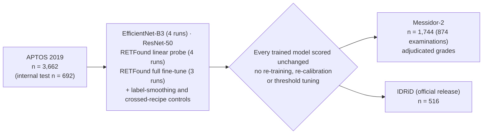

# Retinal foundation-model versus ImageNet pretraining for deep learning grading of diabetic retinopathy: an external validation study

[](https://github.com/Pravinraje0761/DIABETICS-AND-FUNDUS-IMAGES/actions/workflows/ci.yml)
[](LICENSE)


Companion repository for the manuscript by **Pravin Raj E** (Department of Artificial
Intelligence and Data Science, Chennai Institute of Technology, Chennai, India).

Retinal foundation models such as **RETFound** are expected to make diabetic retinopathy (DR)
grading more robust to a change of camera, population or grading protocol. This study tests
that expectation. RETFound (frozen linear probe and full fine-tuning), EfficientNet-B3 and
ResNet-50 were developed on **APTOS 2019** and evaluated, unchanged, on two independent
external datasets: **Messidor-2** (adjudicated specialist grades) and the official **IDRiD**
release.

**Result: retinal foundation-model pretraining did not reduce the loss of grading agreement on
external data.** External performance varied between training runs and was closely tied to case
mix and to the no-DR/mild boundary.

> **Not for clinical use.** Retrospective study of public, de-identified datasets; no prospective
> or clinical validation. See [Limitations](#limitations).

---

## Study design



- **Primary outcome:** difference in internal-to-external quadratic weighted kappa (QWK) drop
  versus EfficientNet-B3, averaged over training runs. Inference uses a two-level bootstrap
  (training runs and images; Messidor-2 resampled by examination using the official ADCIS
  examination file) with Holm adjustment over the four RETFound contrasts.
- **Secondary outcomes:** referable-DR (grade ≥ 2) sensitivity, specificity, PPV, NPV and AUC;
  case-mix and no-DR/mild boundary analysis; calibration; uncertainty-based referral; saliency
  localisation against expert lesion masks (IDRiD Segmentation, n = 81).
- Changes to the original analysis plan, with the original results, are listed in the manuscript
  (Methods, "Changes to the analysis plan") and Online Resource 1 (S0).

## Key findings

| Comparison (vs EfficientNet-B3) | Messidor-2 | IDRiD |
|---|---|---|
| RETFound full fine-tune, excess QWK drop (mean of 3 runs) | +0.068 (95% CI +0.003 to +0.134; Holm *p* = 0.074) | +0.020 (−0.041 to +0.080; Holm *p* = 0.550) |
| RETFound linear probe, excess QWK drop (mean of 4 runs) | +0.085 (+0.021 to +0.146; Holm *p* = 0.039) | +0.094 (+0.034 to +0.155; Holm *p* = 0.016) |
| Both trained with the RETFound recipe (seed 42) | +0.021 (−0.023 to +0.067) | +0.010 (−0.044 to +0.068) |
| Both trained with the CNN recipe (seed 42) | +0.088 (+0.043 to +0.132) | −0.006 (−0.063 to +0.047) |

1. **No robustness benefit from retinal pretraining.** Fine-tuned RETFound and EfficientNet-B3
   were similar internally (QWK 0.888 vs 0.879); externally RETFound's drop was larger on
   Messidor-2 (not significant after adjustment) and similar on IDRiD. Neither fine-tuning recipe
   gave RETFound an advantage.
2. **Single runs can mislead.** The first RETFound run suggested a Messidor-2 drop similar to the
   CNN's; two further runs differing only in seed degraded more.
3. **Errors concentrate at the no-DR/mild boundary.** On Messidor-2 every model preserved
   specificity (90–98%) but referable-DR sensitivity was 36–43%; EfficientNet-B3 graded 259 of
   270 mild and 249 of 347 moderate images as no DR. On IDRiD the errors went the other way.
   Matching case mix and merging no and mild DR reduced the Messidor-2 drop by 63–69%. These
   corrections are descriptive and cannot separate a grading-convention difference from poorer
   visibility of subtle lesions.
4. **RETFound's calibration advantage is a recipe effect.** Label smoothing alone reproduced it in
   EfficientNet-B3, and RETFound trained without its usual recipe was over-confident externally.
5. **Referral helps on one dataset only.** Referring the least confident 30% of images to a
   grader cut missed referable DR on Messidor-2 from 61% to 28% (EfficientNet-B3), but gave no
   benefit over random referral on IDRiD.
6. **Saliency localises lesions weakly.** RETFound's maps separated lesion from background pixels
   better than the CNN's (pixel AUC 0.668 vs 0.606), partly because of its finer grid; at most 19%
   of the most salient pixels fell on lesions for any model.

## Manuscript and supplementary material

| Location | Contents |
|---|---|
| [`paper/submission_io_final/`](paper/submission_io_final/) | Journal version (Springer Nature template): manuscript PDF, Overleaf/LaTeX package, figures, Online Resources 1–4, cover letter, submission steps |
| [`paper/preprint_biorxiv/`](paper/preprint_biorxiv/) | Preprint version (two-column layout) with LaTeX source and Online Resources |
| [`paper/submission_io/generated/numbers.json`](paper/submission_io/generated/numbers.json) | Every number in the manuscript, generated by script from the prediction files |

## Reproducing the results

Per-image predictions for every model, training run and dataset are committed under
`outputs/phase6/` and `outputs/phase28/`, so every statistic, table and figure can be regenerated
**without a GPU or the raw images**:

```bash
git clone https://github.com/Pravinraje0761/DIABETICS-AND-FUNDUS-IMAGES.git
cd DIABETICS-AND-FUNDUS-IMAGES
python -m venv .venv && source .venv/bin/activate     # Windows: .venv\Scripts\activate
pip install -r requirements.txt

pytest                                         # recomputes Table 3 and checks the generated numbers
python scripts/phase31_paper_numbers.py --model baseline_efficientnet_b3   # one model's bootstrap
python scripts/phase31_paper_numbers.py --merge                            # contrasts across models
python scripts/phase32_tex_numbers.py          # writes every manuscript number as a LaTeX macro
python scripts/phase33_figures.py              # Figures 1-5
```

The Messidor-2 examination-level bootstrap needs the ADCIS examination file (`messidor-2.csv`,
distributed with the Messidor-2 release; not redistributed here) copied to
`data_splits/messidor2_official_pairs_adcis.csv`, then `python scripts/phase30b_official_pairs.py`.

Retraining needs the raw datasets (see [Data](#data)), a GPU and the gated RETFound weights
([`docs/phase_reports/PHASE5_SETUP.md`](docs/phase_reports/PHASE5_SETUP.md)). The launchers
`run_round3_gpu.bat`, `run_round4_gpu.bat` and `run_seedpreds_cpu.bat` give the exact arguments of
every run (seeds, label-smoothing control, crossed recipes); `requirements-lock.txt` pins the full
environment (Python 3.14, PyTorch 2.11, CUDA 12.8, RTX 5060). [`docs/PIPELINE.md`](docs/PIPELINE.md)
lists every phase with its script and outputs. CI runs the tests on Python 3.12.

## Repository layout

```
scripts/        one script per analysis phase, plus shared modules (preprocessing, metrics, models)
data_splits/    fixed APTOS split and per-dataset manifests (image IDs only, no images)
outputs/        per-image predictions, metrics, statistics and figures for every phase
paper/          journal and preprint versions, generated numbers, figures, references
docs/           pipeline guide, analysis plan, phase reports, project notes
tests/          recompute-the-paper tests and unit tests (run in CI)
```

## Data

The datasets are third-party and are **not redistributed**. Download them from their sources
under their own licences; [`DATA_PROVENANCE.md`](DATA_PROVENANCE.md) records the URL, version,
access date, licence and citation for each.

| Dataset | n | Role | Source |
|---|--:|---|---|
| APTOS 2019 Blindness Detection | 3,662 | Development only | Kaggle |
| Messidor-2 (adjudicated grades, Krause et al. 2018) | 1,744 | External test | ADCIS |
| IDRiD, Disease Grading (official release) | 516 | External test | IEEE DataPort |
| IDRiD, Segmentation (lesion masks) | 81 | Saliency localisation | IEEE DataPort |

An earlier version of the analysis used a third-party copy of IDRiD; 27 of its 455 labels (5.9%)
differed from the official release. All results use the official release
(`outputs/phase28/mirror_audit.md`).

## Limitations

- Retrospective study of curated public datasets; neither external set is a consecutive screening
  population.
- One retinal foundation model, one development dataset and one input resolution (224 × 224).
- Three or four training runs per family estimate run-to-run variation imprecisely; the crossed-recipe
  controls are single runs; the primary analysis was changed after the second RETFound run was seen
  (both analyses are reported).
- APTOS and IDRiD provide no patient identifiers.
- The case-mix and no-DR/mild boundary corrections are descriptive.
- Saliency was evaluated on 81 images from one dataset with one attribution method per family.

## Citation

The manuscript is not yet published. Until it is, please cite the software via GitHub's
"Cite this repository" button ([`CITATION.cff`](CITATION.cff)). If you use the datasets or
RETFound, please also cite their original papers (listed in `paper/submission_io_final/overleaf/references.bib`).

## License

Code is released under the [MIT License](LICENSE). Datasets and the RETFound weights keep their
own licences and are not included.
