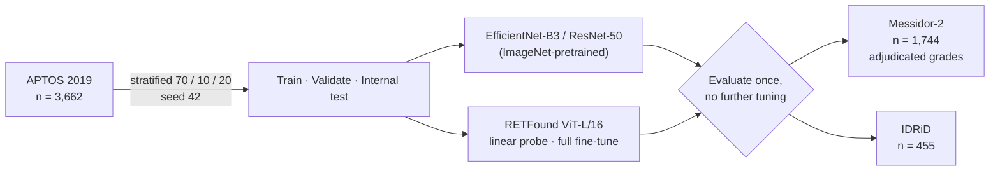

# Cross-Dataset External Validation of a Retinal Foundation Model for Diabetic Retinopathy Grading

**Performance, explainability, and uncertainty under dataset shift**

[](https://github.com/Pravinraje0761/DIABETICS-AND-FUNDUS-IMAGES/actions/workflows/ci.yml)
[](LICENSE)


Retinal foundation models such as **RETFound** are promoted as improving generalisation.
This study tests that claim for five-class diabetic retinopathy (DR) grading under fully
matched conditions. One preprocessing pipeline, one fine-tuning protocol and one evaluation
protocol are applied identically to an ImageNet-pretrained CNN and to RETFound. Both are
trained on **APTOS 2019** and then evaluated, unchanged and once, on two independent external
datasets: **Messidor-2** and **IDRiD**.

**Result: RETFound did not generalise better. On the pre-specified contrasts, it generalised
worse.** Every model degraded sharply on external data. Predictive uncertainty was a weak
safeguard under that shift.

> **Not for clinical use.** Retrospective study on public datasets; no prospective or
> clinical validation. See [Limitations](#limitations).

---

## Study design



Messidor-2 and IDRiD were not used for any modelling or tuning decision before the single
external evaluation.

## Key findings

1. **No generalisation advantage for the foundation model.** RETFound's internal-to-external
   QWK drop on Messidor-2 was significantly larger than the CNN baseline's: +0.124 (95% CI
   0.074–0.175) for full fine-tuning and +0.076 (0.019–0.132) for linear probing.
2. **The CNN separates referable DR better on external data.** EfficientNet-B3 had a
   significantly higher referable-DR (ICDR ≥ 2) AUC than every RETFound variant on both
   external datasets (DeLong *p* < 0.001), despite parity internally (*p* ≥ 0.47).
3. **Every model collapses on Messidor-2.** QWK fell from about 0.87 internally to 0.37–0.50,
   with models reverting toward predicting grade 0.
4. **Uncertainty is a weak safeguard under shift.** Entropy detected errors with AUROC up to
   0.84 internally but only 0.55–0.68 externally. Referring the 10% most uncertain external
   cases caught only 9–18% of errors, close to random referral.
5. **Saliency shifts with the domain.** CNN saliency stayed on retinal tissue externally;
   RETFound's moved to the image periphery on Messidor-2, most for its errors.
6. **Partial counterpoint: calibration.** RETFound's probabilities stayed better calibrated
   under shift (ECE 0.10–0.16 vs. 0.26–0.29 for the CNNs), though temperature scaling did not
   close the discrimination gap.

## Results

### Master results (manuscript Table 2; 95% bootstrap CIs, B = 2000)

| Model | Dataset | n | QWK | Accuracy | Macro AUC |
|---|---|--:|---|---|---|
| **EfficientNet-B3** (baseline) | APTOS internal | 733 | 0.876 (0.849–0.901) | 0.804 | 0.928 |
| | Messidor-2 | 1,744 | 0.499 (0.452–0.543) | 0.626 | 0.775 |
| | IDRiD | 455 | 0.760 (0.715–0.798) | 0.497 | 0.830 |
| ResNet-50 (baseline) | APTOS internal | 733 | 0.875 (0.848–0.898) | 0.789 | 0.924 |
| | Messidor-2 | 1,744 | 0.435 (0.381–0.481) | 0.614 | 0.754 |
| | IDRiD | 455 | 0.707 (0.663–0.751) | 0.448 | 0.841 |
| RETFound, linear probe | APTOS internal | 733 | 0.847 (0.819–0.873) | 0.759 | 0.908 |
| | Messidor-2 | 1,744 | 0.394 (0.338–0.447) | 0.589 | 0.758 |
| | IDRiD | 455 | 0.626 (0.572–0.676) | 0.336 | 0.778 |
| RETFound, full fine-tune † | APTOS internal | 733 | 0.869 (0.842–0.893) | 0.769 | 0.915 |
| | Messidor-2 | 1,744 | 0.368 (0.311–0.422) | 0.602 | 0.758 |
| | IDRiD | 455 | 0.720 (0.673–0.759) | 0.420 | 0.821 |

† Provisional: epoch-6 checkpoint (see [Limitations](#limitations)). The conclusion also
holds for the linear probe, which ran to a clean early stop.

### Internal-to-external QWK drop (manuscript Table 3)

| Model | Messidor-2 drop | Δ vs. baseline | IDRiD drop | Δ vs. baseline |
|---|---|---|---|---|
| EfficientNet-B3 | 0.377 (0.323–0.433) | reference | 0.116 (0.068–0.166) | reference |
| ResNet-50 | 0.440 (0.388–0.499) | +0.063 (0.017–0.109) | 0.167 (0.117–0.222) | +0.051 (0.003–0.102) |
| RETFound, linear probe | 0.453 (0.393–0.516) | **+0.076 (0.019–0.132)** | 0.221 (0.163–0.285) | **+0.105 (0.038–0.170)** |
| RETFound, full fine-tune † | 0.501 (0.441–0.563) | **+0.124 (0.074–0.175)** | 0.150 (0.101–0.202) | +0.033 (−0.022–0.089) |

Difference-in-drop intervals are paired at the image level. An interval excluding 0 means a
significantly larger loss of external agreement than the baseline.

### Robustness of the conclusion

| Check | Outcome | Outputs |
|---|---|---|
| Training seed (4 seeds per model) | Messidor-2 drop 0.461 ± 0.017 (RETFound linear probe) vs. 0.379 ± 0.025 (CNN); seed distributions do not overlap | `outputs/phase16/` |
| Loss function (weighted CE, plain CE, focal) | CNN keeps the smaller Messidor-2 drop under every loss; IDRiD is loss-sensitive and the ordering reverses there under plain CE | `outputs/phase17/` |
| Referable DR as a binary task | RETFound's AUROC drop exceeds the baseline's on both external sets | `outputs/phase19/` |
| Inference-time CLAHE, colour transfer, 224 vs. 384 px | Direction of the RETFound–CNN gap unchanged | `outputs/phase15/`, `outputs/phase15c/` |
| Duplicate / leakage check | 0 byte-identical images across datasets; removing internal APTOS duplicates moves internal QWK by ≤ 0.006 | `outputs/phase12/`, `outputs/phase14/` |
| Independent recompute | All 60 headline cells re-derived from prediction files, agreeing to < 5 × 10⁻⁴ | `outputs/phase11/verification.csv` |

## Reproducing the results

Per-image predictions for every model × dataset are committed under `outputs/phase6/`, so all
statistics and figures can be regenerated **without a GPU or the raw images**:

```bash
git clone https://github.com/Pravinraje0761/DIABETICS-AND-FUNDUS-IMAGES.git
cd DIABETICS-AND-FUNDUS-IMAGES
python -m venv .venv && source .venv/bin/activate     # Windows: .venv\Scripts\activate
pip install -r requirements.txt

pytest                                                 # recomputes Table 2 and the DeLong tests
python scripts/phase9_stats.py --boot 2000 --seed 42   # bootstrap CIs, drop CIs, DeLong
python scripts/phase10_figures.py                      # figures
```

Retraining from scratch needs the raw datasets (see [Data](#data)), a GPU, and the gated
RETFound weights ([`docs/phase_reports/PHASE5_SETUP.md`](docs/phase_reports/PHASE5_SETUP.md)).
[`docs/PIPELINE.md`](docs/PIPELINE.md) lists every phase with its script and outputs, and the
manuscript's reproducibility table maps each table and figure to its script.

The original environment was Python 3.14 on Windows with PyTorch 2.11 (CUDA 12.8) on an RTX 5060
(8 GB); `requirements.txt` pins these versions. CI runs the analysis tests on Python 3.12.

## Repository layout

```
scripts/        one script per analysis phase, plus shared modules (preprocessing, metrics, models)
data_splits/    fixed APTOS split and per-dataset manifests (image IDs, no images)
outputs/        per-image predictions, metrics, statistics and figures for every phase
paper/          manuscript (main_standalone.tex), references, TRIPOD+AI checklist, figures
docs/           pipeline guide, analysis plan, phase reports, project notes
tests/          recompute-the-paper tests and unit tests (run in CI)
logs/           preprocessing and split configuration
```

## Data

The datasets are third-party and are **not redistributed**. Download them from their sources
under their own licences; [`DATA_PROVENANCE.md`](DATA_PROVENANCE.md) records the URL, version,
access date, licence and citation for each.

| Dataset | n | Role | Source |
|---|--:|---|---|
| APTOS 2019 Blindness Detection | 3,662 | Development only | Kaggle |
| Messidor-2 (adjudicated grades, Krause et al. 2018) | 1,744 | External test | ADCIS |
| IDRiD, Disease Grading | 455 of 516 | External test | IEEE DataPort |

## Limitations

- The RETFound full fine-tune uses an epoch-6 checkpoint: two full 30-epoch runs were cut short
  by hardware limits. Its values are marked provisional, and the conclusion also holds for the
  linear probe. [`COLAB_RETRAIN_GUIDE.md`](COLAB_RETRAIN_GUIDE.md) describes the clean re-run.
- Retrospective, public data only; no prospective or clinical-deployment claim.
- The IDRiD mirror used had 455 of the 516 images.
- Grade-1 (mild) sensitivity is not estimable on Messidor-2; some CIs are wide.
- Saliency plausibility is scored by an automated location proxy, not by blinded expert graders.
- One foundation model and one task; results should not be generalised beyond them without testing.

The manuscript discusses each in full.

## Citation

The manuscript is not yet published. Until it is, please cite the software:

```bibtex
@software{pravinraj_dr_external_validation_2026,
  author = {Pravin Raj E},
  title  = {Cross-Dataset External Validation of a Retinal Foundation Model for
            Diabetic Retinopathy Grading: Performance, Explainability, and Uncertainty (code)},
  year   = {2026},
  url    = {https://github.com/Pravinraje0761/DIABETICS-AND-FUNDUS-IMAGES}
}
```

GitHub's "Cite this repository" button uses [`CITATION.cff`](CITATION.cff). If you use the
datasets or RETFound, please also cite their original papers (listed in `paper/references.bib`).

## License

Code is released under the [MIT License](LICENSE). Datasets and the RETFound weights keep their
own licences and are not included.
