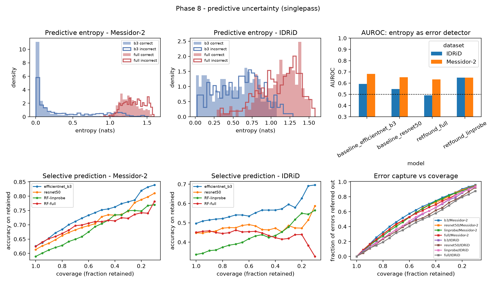
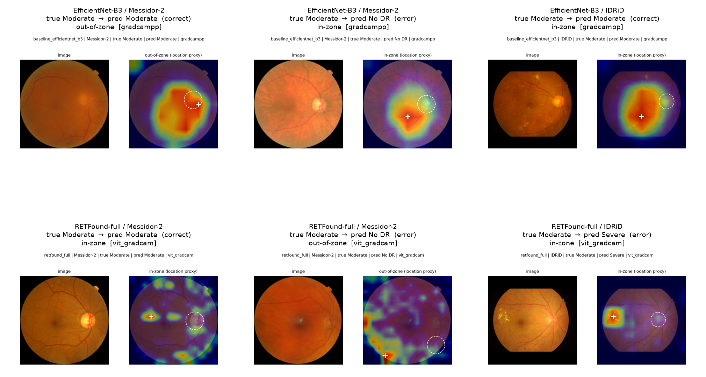

# Cross-Dataset External Validation of a Retinal Foundation Model for Diabetic Retinopathy Grading: Performance, Explainability, and Uncertainty

Pravin Raj E (independent researcher; ORCID 0009-0000-2975-1631; epravinraj0761@gmail.com)

_Plain-text render of `paper/main_standalone.tex` (pandoc), regenerated 2026-10-21. The LaTeX file is authoritative._

## Abstract

Retinal foundation models such as RETFound are expected to generalise better than ImageNet-pretrained networks, but protocol-matched external validation for diabetic retinopathy (DR) grading is scarce. We applied one preprocessing, fine-tuning, and evaluation protocol to ImageNet-pretrained EfficientNet-B3 (primary baseline) and ResNet-50 and to RETFound (ViT-Large/16; linear probing and full fine-tuning), trained them on APTOS 2019 ($n=3662$), and evaluated them unchanged on Messidor-2 ($n=1744$; adjudicated reference standard) and a $455$-image copy of IDRiD. The primary outcome was the quadratic-weighted kappa (QWK). The confirmatory family was the paired difference in internal-to-external QWK drop between each RETFound variant and EfficientNet-B3 on each external set (four contrasts, Holm-adjusted). Internally, fully fine-tuned RETFound and EfficientNet-B3 were indistinguishable (QWK $0.882$ vs. $0.876$; paired difference $+0.006$, $95\%$ CI $-0.014$ to $0.029$). Every model degraded externally, most on Messidor-2 (EfficientNet-B3 QWK $0.499$, drop $0.377$). Fully fine-tuned RETFound generalised neither better nor measurably worse than the CNN: its excess drop was $+0.018$ ($95\%$ CI $-0.024$ to $0.058$) on Messidor-2 and $+0.022$ ($-0.033$ to $0.083$) on IDRiD (Holm $p=0.79$ for both). The RETFound linear probe degraded more than the CNN on both sets ($+0.076$, $0.019$ to $0.132$, Holm $p=0.030$; $+0.105$, $0.038$ to $0.170$, Holm $p=0.016$). In secondary analyses the CNN had a higher referable-DR AUC than fully fine-tuned RETFound on IDRiD ($0.962$ vs. $0.885$; DeLong $p<0.001$); RETFound’s label-smoothed probabilities were better calibrated externally (ECE $0.09$–$0.13$ vs. $0.26$–$0.29$); single-pass softmax entropy was a weak external error signal for every model (AUROC $0.49$–$0.68$) and carried none for fully fine-tuned RETFound on IDRiD; and a geometric saliency-location proxy, not a lesion-level assessment, placed RETFound’s saliency on the image border more often than the CNN’s on Messidor-2. In this retrospective study of public datasets, retinal-domain pretraining gave no measurable robustness advantage over a standard ImageNet CNN on these shifts, and the external performance of every model falls far short of what clinical use would require.

Diabetic retinopathy, retinal foundation models, RETFound, external validation, domain shift, quadratic-weighted kappa, explainability, uncertainty quantification, retinal imaging.

# Introduction

Diabetic retinopathy (DR) is a leading cause of preventable vision loss, and the number of people who need regular retinal screening grows faster than the number of graders able to read their photographs. Automated grading of colour fundus photographs is the obvious response, and supervised deep networks have reached specialist-level agreement on the data they were developed on . The difficulty begins when such a model meets images it was not built for. Performance has repeatedly fallen when cameras, populations, image quality, or the grading protocol change , and reviews of DR screening AI note that external validation, the test that would reveal this, is still reported inconsistently .

Self-supervised foundation models are often presented as the answer to this fragility. RETFound , a Vision Transformer pretrained with masked autoencoding on about $1.6$ million unlabelled retinal images, is the best-known example for fundus photographs. The intuition is appealing: a representation learned from many retinas, rather than from ImageNet’s everyday objects, should capture retinal structure that survives a change of camera or clinic. RETFound was reported to transfer well to several ocular and systemic tasks . Whether that intuition holds for DR grading under dataset shift has been tested less directly. Hou et al.  fine-tuned RETFound and a natural-image foundation model (DINOv2) on the same three public DR datasets used here and evaluated them across datasets; the natural-image model generally had the higher AUC. Other recent DR studies have paired external validation with lesion-level evidence or with uncertainty estimates , but for supervised architectures rather than a retinal foundation model.

Three things are therefore still unresolved. First, it is not established whether retinal-domain pretraining makes DR *grading* more robust than the standard alternative that most deployed systems still use — a supervised, ImageNet-pretrained convolutional network — when both are trained, tuned, and evaluated in exactly the same way. Comparisons between foundation models, or between models trained under different recipes, cannot answer this. Second, the quantity that matters for robustness is not a model’s external score but how much it *loses* between internal and external data, and whether that loss differs between models by more than chance; this difference is rarely the pre-specified estimand. Third, when a model does degrade, it matters whether its own confidence warns the user. A model that fails while appearing uncertain is far less dangerous than one that fails confidently. The answers matter in practice: if retinal pretraining does not buy robustness, then choosing a foundation model is not a substitute for external validation, and internal parity between architectures says little about how they will behave elsewhere.

We address these gaps with a matched cross-dataset comparison. One preprocessing pipeline, one fine-tuning protocol, one evaluation protocol, and one statistical treatment were applied to RETFound (as a frozen linear probe and fully fine-tuned) and to ImageNet-pretrained EfficientNet-B3 (primary baseline) and ResNet-50. All models were developed only on APTOS 2019 and then scored once, unchanged, on Messidor-2, whose labels are an adjudicated expert consensus, and on IDRiD, which differs most in camera, resolution, and disease mix. We ask three questions:

- **RQ1 (Performance; primary).** Does RETFound lose less five-class grading agreement (quadratic-weighted kappa, QWK) between internal and external data than an ImageNet-pretrained CNN trained identically?

- **RQ2 (Uncertainty).** When the models err on external images, does their predictive uncertainty separate errors from correct predictions well enough to support referral of uncertain cases, and are their probabilities calibrated?

- **RQ3 (Explainability; exploratory).** Does each model’s saliency on external images fall in the retinal region where DR lesions can occur, rather than on the optic disc or the image border? (Planned as a lesion-plausibility question; without lesion masks or blinded expert raters it can be answered here only by a geometric location proxy, Section <a href="#sec:methods-explain" data-reference-type="ref" data-reference="sec:methods-explain">3.10</a>.)

**What we found, in brief.** Fully fine-tuned RETFound and the CNN were indistinguishable internally, and RETFound neither generalised better nor measurably worse externally; used as a frozen feature extractor, RETFound generalised worse. Every model lost much of its agreement on Messidor-2, and uncertainty did not reliably flag the errors. The study also contains a cautionary episode: an earlier, hardware-interrupted training run had suggested that RETFound generalised significantly worse, and the difference vanished once the pre-specified protocol was run to completion (Section <a href="#sec:discussion" data-reference-type="ref" data-reference="sec:discussion">5</a>).

**Contributions.** (i) A protocol-matched comparison of a retinal foundation model with ImageNet CNNs on external DR grading, in which the inferential target is a pre-specified, multiplicity-controlled family of paired differences in internal-to-external QWK drop (Section <a href="#sec:methods-stats" data-reference-type="ref" data-reference="sec:methods-stats">3.11</a>); (ii) analyses of whether each model’s uncertainty, calibration, and saliency location remain informative under shift; (iii) an audit of the public dataset copies against their canonical releases, including a previously undocumented label discrepancy in a widely shared IDRiD mirror (Section <a href="#sec:methods-idrid" data-reference-type="ref" data-reference="sec:methods-idrid">3.1.1</a>); and (iv) a release of code, split lists, per-image predictions, checkpoint hashes, and an exact environment lock (Section <a href="#sec:repro" data-reference-type="ref" data-reference="sec:repro">8</a>).

**Scope.** This is a retrospective study on public benchmark images. We compare *one* retinal foundation-model checkpoint (RETFound MAE, colour-fundus weights) with ImageNet CNNs on *one* task (five-class DR grading). Nothing here is a prospective, clinical, or reader-study result, and the conclusions should not be extended to other foundation models or tasks without direct testing.

# Background and positioning

**Where external DR evaluation stands.** Large supervised DR systems and a system spanning the full disease spectrum established high performance on their own data; human-centred evaluation of a deployed system showed how poorly curated-test performance predicted clinical behaviour ; and reviews flag generalisation and external validation as under-reported . Recent external-validation studies have begun to report lesion-level evidence and calibrated uncertainty alongside grading accuracy, but for supervised architectures.

**Retinal foundation models.** RETFound adapts masked-autoencoder pretraining to a ViT-Large on large unlabelled retinal collections (about $1.6$ M colour fundus and OCT images in total; we use the colour-fundus checkpoint). The closest prior work, Hou et al. , compared RETFound with DINOv2 on APTOS 2019, IDRiD, and Messidor-2, including cross-dataset testing, and reported AUC; the natural-image model generally scored higher on DR. That study compared two foundation models. It did not compare RETFound with a supervised ImageNet CNN under one protocol, nor take the internal-to-external drop in an ordinal grading metric as the estimand, nor ask whether uncertainty flags external errors — the three questions posed here.

**Positioning.** We make no claim of being first to externally validate DR AI or to evaluate RETFound. The contribution is a specific, reproducible combination: one foundation model and two ImageNet CNNs under a matched preprocessing, fine-tuning, and evaluation protocol, with the paired difference in internal-to-external QWK drop as a multiplicity-controlled primary estimand, plus matched analyses of uncertainty, calibration, and saliency location, and a full release. ResNet-50 and EfficientNet-B3 were chosen as baselines because ImageNet-pretrained CNNs of this kind are the usual reference point for pretrained representations in medical imaging.

# Materials and Methods

This study followed the TRIPOD+AI reporting guideline ; the completed checklist is provided as supplementary material (`paper/TRIPOD-AI_checklist.md`). Figure <a href="#fig:pipeline" data-reference-type="ref" data-reference="fig:pipeline">[fig:pipeline]</a> summarises the design: freeze the datasets into development and external roles, apply one preprocessing pipeline, fine-tune every model on APTOS only, and evaluate once externally with a common resampling-based statistical treatment.

## Datasets

Three public datasets were used (Table <a href="#tab:datasets" data-reference-type="ref" data-reference="tab:datasets">1</a>; Figure <a href="#fig:grades" data-reference-type="ref" data-reference="fig:grades">1</a>). All three were downloaded and extracted on 2026-09-08 (the file-system date of every raw image and label file), which is taken as the access date. Source, version, licence, and the full audit of each local copy against its canonical release are in `DATA_PROVENANCE.md`.

- **APTOS 2019 Blindness Detection** : the $3662$ labelled images of the Kaggle competition release (Aravind Eye Hospital, India; gathered from multiple clinics and cameras). The unlabelled $1928$-image Kaggle holdout was not used. Licence: Kaggle competition rules (non-commercial research; no redistribution). Used *only* for model development (training, validation, internal test).

- **Messidor-2** : the canonical ADCIS release has $874$ examinations, each two macula-centred images (one per eye), $1748$ images in total. We used the $1744$ images graded gradable under the adjudicated reference standard of Krause et al. ; the four absent images are exactly those marked ungradable. Licence: ADCIS terms (research and education; no redistribution). External test only.

- **IDRiD** (Disease-Grading subset) : the official IEEE DataPort release (doi:10.21227/H25W98, CC BY 4.0) has $516$ images ($413$ train $+$ $103$ test). The copy used here, a third-party Kaggle mirror, contains $455$ of them ($375$ train IDs, $80$ test IDs); Section <a href="#sec:methods-idrid" data-reference-type="ref" data-reference="sec:methods-idrid">3.1.1</a> characterises the $61$ missing images and a label discrepancy found in the mirror. External test only; both official IDRiD splits were pooled because neither was used for training.

### Audit of the IDRiD copy

The $61$ missing images ($38$ train IDs, $23$ test IDs; listed in `data_splits/idrid_missing_vs_official.csv`) fall mostly in contiguous ID runs ($22$ of the $38$ train IDs lie in 138–173), which suggests an incomplete upload rather than selection by grade, although the cause cannot be established. Against the official per-grade counts ($168/25/168/93/62$ for grades 0–4), the mirror’s $129/22/156/84/64$ under-represents grade 0 ($28.4\%$ vs. $32.6\%$) and raises the referable-DR prevalence from $62.6\%$ to $66.8\%$. The mirror also holds more grade-4 images among the official *train* IDs ($55$) than the official train set contains ($49$), and more grade-3 images among the test IDs ($20$ vs. $19$); removing images cannot produce this, so at least $7$ of the $455$ mirror labels ($\geq 1.5\%$) differ from the official grades. The exact number cannot be determined without the official per-image label file. To bound the effect of the class-mix difference we re-weighted the $455$ images by grade to the official $516$-image mix (Section <a href="#sec:methods-stats" data-reference-type="ref" data-reference="sec:methods-stats">3.11</a>); the label discrepancy is a separate, stated limitation (Section <a href="#sec:limitations" data-reference-type="ref" data-reference="sec:limitations">6</a>).

### Reference standards and their comparability

The three reference standards were produced differently. APTOS labels were assigned by one clinician per image on a 0–4 scale; no second reading or adjudication is described . Messidor-2 labels are the adjudicated consensus of three fellowship-trained retina specialists who graded independently on the ICDR scale and resolved every disagreement in adjudication sessions . IDRiD labels were assigned by “medical experts” on a 0–4 scale based on the ICDR scale; the number of graders and any adjudication are not reported . An internal-to-external QWK drop therefore combines image-domain shift with a change of labelling protocol, and QWK values are not directly comparable *across* the two external datasets. Because every model is scored against the same labels on the same images, this protocol difference does not by itself favour either model in the between-model contrasts that form the primary inference (Section <a href="#sec:methods-stats" data-reference-type="ref" data-reference="sec:methods-stats">3.11</a>), but it does limit how much of each model’s absolute drop can be attributed to the images.

Messidor-2 and IDRiD were not used for any modelling, hyperparameter, checkpoint, or threshold decision (Section <a href="#sec:methods-lock" data-reference-type="ref" data-reference="sec:methods-lock">3.7.1</a>).

| Dataset    |    $n$ | Role          |  Grades 0/1/2/3/4 (%)   |
|:-----------|-------:|:--------------|:-----------------------:|
| APTOS 2019 | $3662$ | Development   | 49.3/10.1/27.3/5.3/8.1  |
| Messidor-2 | $1744$ | External test | 58.3/15.5/19.9/4.3/2.0  |
| IDRiD      |  $455$ | External test | 28.4/4.8/34.3/18.5/14.1 |

Dataset characteristics. Grade share is the percentage of gradable images at each ICDR severity level. See Figure <a href="#fig:grades" data-reference-type="ref" data-reference="fig:grades">1</a> for a visual comparison.

<figure id="fig:grades">
<embed src="figures/fig_grades.pdf" />
<figcaption>ICDR grade distribution by dataset. APTOS and Messidor-2 are grade-0-dominated; IDRiD is pathology-enriched (modal grade 2), which shapes the interpretation of its internal-to-external drop (Section <a href="#sec:results-ext" data-reference-type="ref" data-reference="sec:results-ext">4.2</a>).</figcaption>
</figure>

## Domain-shift characterisation

Table <a href="#tab:shift" data-reference-type="ref" data-reference="tab:shift">[tab:shift]</a> contrasts the three datasets on the acquisition and labelling axes that plausibly drive the external drop: country and population, camera and mydriasis, native resolution and field of view, illumination/colour uniformity, image quality, DR-grade prevalence, and the reference standard. The two external sets differ from APTOS in complementary ways: Messidor-2 shares the $\approx$<!-- -->45$^\circ$ macula-centred geometry and has a *lower* referable-DR prevalence but a stricter, adjudicated-consensus reference standard, whereas IDRiD differs most on resolution, mydriasis, and prevalence (referable-DR $66.8\%$ in the copy used here versus $40.6\%$ in APTOS). Section <a href="#sec:results-ext" data-reference-type="ref" data-reference="sec:results-ext">4.2</a> interprets the two failure modes against this table.

## Preprocessing

A single preprocessing script was applied identically to all three datasets: (i) conversion to RGB; (ii) tolerance-based cropping of the black frame around the circular fundus; (iii) zero-padding to a centred square (aspect ratio preserved); (iv) bilinear resizing to $224\times224$ (RETFound’s native input). Channel normalisation used ImageNet statistics ($\mu=(0.485,0.456,0.406)$, $\sigma=(0.229,0.224,0.225)$), consistent with RETFound’s downstream configuration. Contrast-limited adaptive histogram equalisation was implemented as an optional step and was *not* applied in the primary analysis. Messidor-2’s mirror mixes vendor-preprocessed and original frames in one folder; the single pipeline was applied to all $1744$ images regardless of source form. All $5861$ preprocessed images passed a stratified visual audit for label–image alignment.

## Development split

APTOS 2019 was partitioned $70\%/10\%/20\%$ into training, internal validation, and internal test, stratified by DR grade, with a fixed random seed ($42$); the exact image-ID lists are released (`data_splits/aptos_{train,val,test}.csv`). Table <a href="#tab:counts" data-reference-type="ref" data-reference="tab:counts">2</a> gives the per-split, per-grade image counts.

**Duplicate / leakage check.** A byte-level (MD5) check of all $5861$ preprocessed images (`scripts/phase12_leakage.py`) found *no* exact-duplicate image shared between any two of the three datasets: Messidor-2 and IDRiD contain no byte-copy of an APTOS image or of each other, so the external validation is uncontaminated. Within APTOS, which is known to contain repeated images, $41$ of the $733$ internal-test images ($5.6\%$) have an exact duplicate in the training or validation split. Removing them changes the internal-test QWK by $+0.001$ to $+0.006$ and accuracy by $+0.007$ to $+0.013$ for every model (the duplicated images were slightly harder than average, so the leakage marginally *understates* internal performance rather than inflating it); the direction of every internal comparison is unchanged (`outputs/phase12/dedup_internal_metrics.csv`). All external numbers, which are the paper’s focus, are unaffected. A semantic near-duplicate check (ImageNet-pretrained EfficientNet-B3 features, $1536$-d, cosine similarity over all cross-dataset image pairs; `scripts/phase14_embedding_dedup.py`) supports the byte-level result: no cross-dataset pair exceeded cosine $0.965$ and none reached $0.98$, with no cluster near $1.0$, i.e. no evidence of semantically duplicated images across datasets (`outputs/phase14/`).

**Patient- and eye-level linkage.** None of the three releases provides a patient identifier. APTOS image IDs are opaque hashes with no patient, eye, or visit field, so the APTOS split is image-level, and both eyes or repeat images of one patient can fall on both sides of it. The checks that were possible — the exact-duplicate check above and the deduplicated re-scoring — bound only the identical-image part of that risk; fellow-eye or repeat-visit images that are not byte-identical cannot be detected, and the internal estimates may be optimistic for that reason. This does not affect the external sets, which were never used for training. Within Messidor-2, each examination contributes two images (one per eye); the ADCIS pairing spreadsheet is not part of the copy used here, so images could not be grouped by examination. IDRiD has no patient identifiers. Image-level bootstrap intervals therefore treat possibly correlated images as independent, and we report a worst-case sensitivity analysis that halves the effective sample size of every test set (Section <a href="#sec:methods-stats" data-reference-type="ref" data-reference="sec:methods-stats">3.11</a>).

| Split                 |  $n$ |   g0 |  g1 |  g2 |  g3 |  g4 |
|:----------------------|-----:|-----:|----:|----:|----:|----:|
| APTOS train           | 2562 | 1263 | 259 | 699 | 135 | 206 |
| APTOS validation      |  367 |  181 |  37 | 100 |  19 |  30 |
| APTOS internal test   |  733 |  361 |  74 | 200 |  39 |  59 |
| Messidor-2 (external) | 1744 | 1017 | 270 | 347 |  75 |  35 |
| IDRiD (external)      |  455 |  129 |  22 | 156 |  84 |  64 |

Image counts by split and ICDR grade. APTOS is split $70/10/20$ stratified by grade (seed $42$); Messidor-2 and IDRiD are used whole as external test sets.

## Models and fine-tuning

**Baseline CNN.** EfficientNet-B3 (primary) and ResNet-50 (secondary), ImageNet-pretrained (`torchvision`), with the classifier head replaced by a five-way head. Full fine-tuning (all layers unfrozen), AdamW ($\text{lr}=10^{-4}$, weight decay $10^{-4}$), cosine annealing, batch size $32$, mixed precision, up to $30$ epochs with early stopping on internal-validation QWK (patience $7$). The loss was cross-entropy weighted by inverse class frequency. Augmentation: horizontal/vertical flips, $\pm15^{\circ}$ rotation, mild brightness/contrast jitter.

**RETFound.** The ViT-Large/16 masked-autoencoder checkpoint pretrained on colour fundus images was loaded (encoder weights only; pretrained final LayerNorm reused as the pooling norm; fresh five-way head). Two variants were fine-tuned, forming the principal ablation: (a) *linear probing* — backbone frozen, head trained (base $\text{lr}=10^{-3}$, up to $40$ epochs); (b) *full fine-tuning* — all layers unfrozen with layer-wise learning-rate decay ($0.65$), drop-path $0.2$, label smoothing $0.1$, base $\text{lr}=10^{-4}$, batch size $16$, up to $30$ epochs. Data, normalisation, class weighting, metric set, and early-stopping rule were identical to the baseline. All hyperparameters are logged (`outputs/phase{4,5}_/ *_hyperparams.json`).

## Evaluation metrics

Given the marked class imbalance in every dataset, the primary metric was the quadratic-weighted kappa (QWK) , which credits ordinal proximity. Secondary metrics: overall accuracy, macro-averaged F1, balanced accuracy, per-class sensitivity and specificity, and one-vs-rest AUC (per class and macro-averaged). The internal-to-external *drop* in each metric is reported per model per external dataset.

## External validation

Each trained model was run once, unmodified and without any further training or threshold tuning, on Messidor-2 and on IDRiD, and re-scored on the APTOS internal test set through the identical inference code path. Per-image outputs (true label, predicted label, class probabilities, predictive entropy) were retained for all model $\times$ dataset combinations.

### Locking the external evaluation

The external sets were kept out of every model decision, and the repository history documents this. All training code and hyperparameter defaults were committed before any external image was scored (CNN trainer 2026-09-08 12:28, RETFound trainer 12:44; first external scoring, of the CNN baselines only, 13:16, local time) and were not changed afterwards: the git diff of both trainers between their first commit and the commits that produced the frozen checkpoints is empty, and later edits added only infrastructure options whose defaults reproduce the original behaviour. Checkpoints were selected by APTOS validation QWK alone; no threshold or temperature was fitted on external data. Contact with external images before scoring was limited to the data audit (counts, label parsing) and to running the already-fixed preprocessing with a visual label–image alignment check. Analyses that scored external sets for *additional* configurations (inference-time ablations, seed and loss sweeps, the head-depth sweep) came after the primary results and did not replace any primary checkpoint. The completed RETFound full fine-tune re-ran the identical pre-specified protocol; its only addition was resume-from-last-epoch to survive hardware interruptions. The four frozen checkpoints used for every primary comparison, every sensitivity-analysis checkpoint, and their SHA-256 hashes are listed in `CHECKPOINTS.md`; the superseded interrupted-run checkpoint and its outputs are retained there for comparison.

## Uncertainty quantification

**Primary measure.** Predictive uncertainty was the Shannon entropy of the softmax output of a single deterministic forward pass (all stochastic layers in evaluation mode). This is a point-estimate confidence score, not a Bayesian or Monte-Carlo estimate.

**Sensitivity analysis (stochastic forward passes).** We repeated the analysis with the entropy of the mean softmax over $T=20$ forward passes in which the layers that were stochastic during training were kept active. What those layers are differs by model, so the label “Monte-Carlo dropout” fits only part of it: for the CNNs it is dropout before the classification head (Monte-Carlo dropout in the sense of ); for the RETFound full fine-tune it is stochastic depth (drop-path, rate $0.2$) in the transformer blocks, which randomly skips residual branches rather than dropping units; and the RETFound linear probe has no stochastic layer in its trained path, so its $T$-pass output equals its single-pass output. We call this the *stochastic-pass* analysis throughout. For each model and external dataset we tested whether misclassified images carried higher entropy than correctly classified images with a one-sided Mann–Whitney $U$ test, reporting the rank-biserial correlation as the effect size, and we computed the AUROC of predictive entropy used directly as a binary error detector. We then plotted selective-prediction curves: images were ranked by entropy and the most uncertain fraction referred out, and the accuracy, quadratic-weighted kappa, and fraction of all errors captured among the referred images were recorded as a function of retained coverage. Predictive entropy and accuracy were also broken down by ICDR grade — stratified both by the reference grade and by the predicted grade — to test whether a model reserved its uncertainty for the rarer sight-threatening grades and whether the many grade-0 predictions it issued on the external sets were made confidently. Code: `scripts/phase8_uncertainty.py`, `scripts/phase8_mc_dropout.py`.

## Calibration

For each model and dataset (internal and external) we computed the expected calibration error (ECE, $15$ equal-width confidence bins), the maximum calibration error (MCE), the multi-class Brier score, and the negative log-likelihood from the stored class probabilities, with a $95\%$ bootstrap CI on ECE, and drew reliability diagrams (`scripts/phase11_review_response.py`). Calibration is reported separately for the internal APTOS test set and the two external sets. As a recalibration check we also fitted a single scalar temperature per model by minimising the negative log-likelihood on the APTOS *validation* split (used for early stopping, never for test or external scoring), applied that temperature unchanged to the internal-test and both external sets, and recomputed every calibration metric (`scripts/phase13_temperature_scaling.py`). The fitted temperature was bootstrapped ($1000$ resamples) for a $95\%$ interval, and the fit was repeated on a disjoint stratified subset of the APTOS training split as a calibration-source robustness check. Temperature scaling is monotonic in the logits, so it leaves accuracy and the quadratic-weighted kappa unchanged.

## Explainability

For a grade-stratified sample of correctly and incorrectly classified external images (image identifiers drawn from the external-validation prediction files with a fixed seed; forty correct and twenty-five incorrect per model per external dataset, $65$ per cell), a saliency map was generated for the model’s predicted class. For the convolutional networks this was a Grad-CAM++ map at the last convolutional block; for the Vision Transformer it was a method-matched Grad-CAM map at the last transformer block (gradient-weighted patch-token activations for the predicted class, class token removed, reshaped to the $14\times14$ patch grid and bilinearly upsampled). Attention-rollout maps were also computed but were more diffuse and border-biased and are reported only in the supplement.

**What was and was not measured.** The study was planned to ask whether saliency overlaps visible DR lesions. That requires lesion masks or blinded expert grading, and neither was available: the IDRiD Disease-Grading subset has no lesion masks, and no clinician rater was recruited. We therefore report only a *geometric location proxy*, and we make no claim about lesion focus or clinical plausibility. A map was labelled *in-zone* when its peak lay inside the fundus, outside an automatically estimated optic-disc region and outside an outer border annulus, and at least half of its top-decile saliency mass lay in that same zone. The zone is where DR lesions *can* occur, but it also contains vessels, the macula, and normal retina, so an in-zone map can be centred on vessels or on no pathology at all; conversely, the proxy is informative mainly in the negative direction, when saliency falls on the border annulus or the disc (Section <a href="#sec:limitations" data-reference-type="ref" data-reference="sec:limitations">6</a>). To make the planned expert assessment executable without re-deriving the sample, we additionally release a blinded rating packet (`scripts/phase7_rating_packet.py`): $160$ maps ($10$ per model per external dataset per correctness stratum, grade-stratified, seed $42$), each re-rendered as a two-panel image (fundus and heatmap only, with no disc marker, peak marker, or identifying text), a shuffled blind identifier, a rating sheet and rubric, and a withheld key; the companion scorer computes the expert lesion-focus rate, the expert-versus-proxy Cohen’s $\kappa$, and the inter-rater $\kappa$ per cell. It has not yet been completed by clinicians, so no expert result is reported. Code: `scripts/phase7_explainability.py`, `scripts/phase7_rating_packet.py`.

## Statistical analysis

**Primary outcome and estimands.** QWK is the single primary outcome. For each model and external dataset the estimand is the internal-to-external QWK drop, and the inferential quantity is the *difference* in that drop between a comparator and the EfficientNet-B3 baseline ($\Delta$drop; positive $=$ the comparator lost more ordinal agreement). We also report the paired difference in QWK itself on each dataset (comparator minus baseline) as a descriptive contrast. Every other metric (accuracy, macro-F1, balanced accuracy, AUC, per-grade sensitivity and specificity, calibration, referable-DR operating points) is secondary.

**Resampling.** Confidence intervals were obtained by non-parametric bootstrap resampling of the relevant test set(s) with replacement ($2000$ iterations; NumPy PCG64 generator, seed $42$), recomputing each metric on every resample and taking the $2.5$th and $97.5$th percentiles . For a drop, the internal APTOS test set and the external set were resampled independently within each iteration. For a between-model contrast, the same resampled image indices were scored for both models, so the contrast is paired at the image level. Two-sided bootstrap $p$-values were obtained by percentile inversion, $p=2\min\{\Pr^*(\hat\theta^*\leq 0),\Pr^*(\hat\theta^*\geq 0)\}$ with the $(k+1)/(B+1)$ correction.

**Confirmatory family and multiplicity.** The confirmatory family is fixed by the research question (RQ1) and has four members: $\Delta$drop for the RETFound full fine-tune and for the RETFound linear probe, each against EfficientNet-B3, on Messidor-2 and on IDRiD. Because a claim that RETFound generalises worse (or better) could rest on any one of these four, we control the family-wise error rate across them: we report Holm-adjusted $p$-values and, alongside each $95\%$ CI, a Bonferroni-adjusted $98.75\%$ CI, and a confirmatory claim is made only when the Holm-adjusted $p<0.05$. The ResNet-50 contrasts are a secondary comparison between two ImageNet CNNs and are not in the family. The DeLong test on the referable-DR binarisation (ICDR grade $\geq 2$; score $=$ summed probability of grades 2–4) is a secondary analysis; its nine comparisons (three comparators $\times$ three datasets) are reported with their own Holm adjustment (`outputs/phase11/multiplicity.csv`). Per-grade one-vs-rest DeLong tests, per-class sensitivities, calibration differences, and all ablation and sensitivity analyses are exploratory: they are reported with unadjusted CIs, are not used for confirmatory claims, and are labelled as exploratory where they appear.

**Sensitivity analyses of the inference.** (i) *Non-independent images.* Because images could not be grouped by patient or examination (Section <a href="#sec:methods-split" data-reference-type="ref" data-reference="sec:methods-split">3.4</a>), we repeated every $\Delta$drop interval with an $m$-out-of-$n$ bootstrap using $m=n/2$ on every test set, which is the interval one would obtain if every image had a perfectly correlated partner (e.g. the fellow eye; Messidor-2 has exactly two images per examination). (ii) *IDRiD missingness.* IDRiD QWK and $\Delta$drop were recomputed with each image weighted by the ratio of its grade’s share in the official $516$-image release to its share in the $455$-image copy (Section <a href="#sec:methods-idrid" data-reference-type="ref" data-reference="sec:methods-idrid">3.1.1</a>). (iii) *Stochastic passes.* The whole procedure was re-run on the $T=20$ stochastic-pass predictive distributions in place of the single forward pass (`outputs/phase8/mc_lp_deterministic/`; the linear probe, which has no training-time stochastic layer, enters with its single-pass predictions). Code: `scripts/phase9_stats.py` (CIs, drops, DeLong), `scripts/phase23_primary_inference.py` (confirmatory family, Holm, paired QWK differences, sensitivity analyses (i)–(ii)), `scripts/phase11_review_response.py` (calibration, per-class CIs). Analyses used `numpy`, `pandas`, `scipy`, and `scikit-learn` in Python 3.14.

Every headline number in Tables <a href="#tab:master" data-reference-type="ref" data-reference="tab:master">[tab:master]</a>–<a href="#tab:delong" data-reference-type="ref" data-reference="tab:delong">[tab:delong]</a> was independently recomputed from the released per-image prediction files with a separate script (`scripts/phase11_review_response.py`); all $60$ recomputed metric cells matched the reported values to within $5\times10^{-4}$.

## Reproducibility

All code (preprocessing, split generation, training, evaluation, statistics), the exact split image-ID lists, per-image prediction files, checkpoint identifiers with SHA-256 hashes, the exact package lock of the environment, and the TRIPOD+AI checklist are released (Section <a href="#sec:repro" data-reference-type="ref" data-reference="sec:repro">8</a>). Raw images and the pretrained RETFound weights are not redistributed, for licence reasons given in Section <a href="#sec:repro" data-reference-type="ref" data-reference="sec:repro">8</a>.

# Results

The results follow the three questions. We first establish that the models start from comparable internal performance (Section <a href="#sec:results-int" data-reference-type="ref" data-reference="sec:results-int">4.1</a>), then answer RQ1 with the primary outcome and test how robust that answer is (Section <a href="#sec:results-ext" data-reference-type="ref" data-reference="sec:results-ext">4.2</a>) and whether it holds for the binary referable-DR decision (Section <a href="#sec:results-referable" data-reference-type="ref" data-reference="sec:results-referable">4.3</a>). RQ2 asks whether the models’ uncertainty and probabilities remain informative once they err (Sections <a href="#sec:results-unc" data-reference-type="ref" data-reference="sec:results-unc">4.4</a>–<a href="#sec:results-ood" data-reference-type="ref" data-reference="sec:results-ood">4.6</a>). RQ3 and two exploratory probes then ask where the models look and how sensitive they are to the input distribution (Sections <a href="#sec:results-explain" data-reference-type="ref" data-reference="sec:results-explain">4.7</a>–<a href="#sec:results-headsummary" data-reference-type="ref" data-reference="sec:results-headsummary">4.9</a>).

## Internal performance

On the APTOS internal test set ($n=733$; Table <a href="#tab:master" data-reference-type="ref" data-reference="tab:master">[tab:master]</a>), EfficientNet-B3 reached QWK $0.876$ ($95\%$ CI $[0.849,0.901]$; accuracy $0.804$), the RETFound full fine-tune QWK $0.882$ ($[0.858,0.905]$; accuracy $0.783$), and the RETFound linear probe QWK $0.847$ ($[0.819,0.873]$). In paired comparisons with EfficientNet-B3, the full fine-tune was indistinguishable (QWK difference $+0.006$, $95\%$ CI $[-0.014,0.029]$), as was ResNet-50 ($-0.001$, $[-0.021,0.019]$), whereas the linear probe was slightly lower ($-0.029$, $[-0.054,-0.005]$; `outputs/phase23/qwk_pairwise_diff.csv`). Both RETFound variants had higher recall on the rare proliferative grade than the CNNs (Figure <a href="#fig:perclass" data-reference-type="ref" data-reference="fig:perclass">[fig:perclass]</a>). These internal estimates may be optimistic because the APTOS split could not be made patient-disjoint (Section <a href="#sec:methods-split" data-reference-type="ref" data-reference="sec:methods-split">3.4</a>).

## External performance and the primary outcome (RQ1)

| Model                      | Dataset        |  $n$ |  Accuracy (95% CI)  |    QWK (95% CI)     |    AUC (95% CI)     |
|:---------------------------|:---------------|-----:|:-------------------:|:-------------------:|:-------------------:|
| EfficientNet-B3 (baseline) | APTOS-internal |  733 | 0.804 (0.776–0.832) | 0.876 (0.849–0.901) | 0.928 (0.911–0.943) |
|                            | Messidor-2     | 1744 | 0.626 (0.603–0.648) | 0.499 (0.452–0.543) | 0.775 (0.761–0.789) |
|                            | IDRiD          |  455 | 0.497 (0.451–0.545) | 0.760 (0.715–0.798) | 0.830 (0.805–0.856) |
| ResNet-50 (baseline)       | APTOS-internal |  733 | 0.789 (0.759–0.819) | 0.875 (0.848–0.898) | 0.924 (0.908–0.939) |
|                            | Messidor-2     | 1744 | 0.614 (0.591–0.635) | 0.435 (0.381–0.481) | 0.754 (0.738–0.769) |
|                            | IDRiD          |  455 | 0.448 (0.400–0.497) | 0.707 (0.663–0.751) | 0.841 (0.818–0.862) |
| RETFound (linear probe)    | APTOS-internal |  733 | 0.759 (0.728–0.789) | 0.847 (0.819–0.873) | 0.908 (0.889–0.927) |
|                            | Messidor-2     | 1744 | 0.589 (0.565–0.612) | 0.394 (0.338–0.447) | 0.758 (0.738–0.774) |
|                            | IDRiD          |  455 | 0.336 (0.297–0.376) | 0.626 (0.572–0.676) | 0.778 (0.751–0.805) |
| RETFound (full fine-tune)  | APTOS-internal |  733 | 0.783 (0.754–0.813) | 0.882 (0.858–0.905) | 0.900 (0.872–0.927) |
|                            | Messidor-2     | 1744 | 0.624 (0.601–0.647) | 0.487 (0.436–0.533) | 0.750 (0.725–0.772) |
|                            | IDRiD          |  455 | 0.451 (0.407–0.499) | 0.744 (0.699–0.787) | 0.819 (0.793–0.845) |

| Model                      | External set | QWK external |    Drop (95% CI)    | $\Delta$Drop vs. baseline (95% CI) | $p_{\mathrm{Holm}}$ |
|:---------------------------|:-------------|:------------:|:-------------------:|:----------------------------------:|:-------------------:|
| EfficientNet-B3 (baseline) | Messidor-2   |    0.499     | 0.377 (0.323–0.433) |           — (reference)            |          —          |
|                            | IDRiD        |    0.760     | 0.116 (0.068–0.166) |           — (reference)            |          —          |
| ResNet-50 (secondary)      | Messidor-2   |    0.435     | 0.440 (0.388–0.499) |       $+0.063$ (0.017–0.109)       |      \[0.005\]      |
|                            | IDRiD        |    0.707     | 0.167 (0.117–0.222) |       $+0.051$ (0.003–0.102)       |      \[0.041\]      |
| RETFound (linear probe)    | Messidor-2   |    0.394     | 0.453 (0.393–0.516) |       $+0.076$ (0.019–0.132)       |        0.030        |
|                            | IDRiD        |    0.626     | 0.221 (0.163–0.285) |       $+0.105$ (0.038–0.170)       |        0.016        |
| RETFound (full fine-tune)  | Messidor-2   |    0.487     | 0.395 (0.345–0.449) |     $+0.018$ ($-0.024$–0.058)      |        0.79         |
|                            | IDRiD        |    0.744     | 0.139 (0.090–0.191) |     $+0.022$ ($-0.033$–0.083)      |        0.79         |

| Dataset        | Comparator              | AUC base | AUC comp. |   $p$    | $p_{\mathrm{Holm}}$ |
|:---------------|:------------------------|:--------:|:---------:|:--------:|:-------------------:|
| APTOS-internal | ResNet-50               |  0.980   |   0.978   |   0.53   |        0.95         |
| APTOS-internal | RETFound linear probe   |  0.980   |   0.976   |   0.47   |        0.95         |
| APTOS-internal | RETFound full fine-tune |  0.980   |   0.967   |  0.089   |        0.31         |
| Messidor-2     | ResNet-50               |  0.842   |   0.789   | $<0.001$ |      $<0.001$       |
| Messidor-2     | RETFound linear probe   |  0.842   |   0.781   | $<0.001$ |      $<0.001$       |
| Messidor-2     | RETFound full fine-tune |  0.842   |   0.817   |  0.023   |        0.11         |
| IDRiD          | ResNet-50               |  0.962   |   0.950   |  0.076   |        0.31         |
| IDRiD          | RETFound linear probe   |  0.962   |   0.903   | $<0.001$ |      $<0.001$       |
| IDRiD          | RETFound full fine-tune |  0.962   |   0.885   | $<0.001$ |      $<0.001$       |

<embed src="figures/fig_forest.pdf" />

<embed src="figures/fig_confusion.pdf" />

<embed src="figures/fig_perclass.pdf" />

Every model degraded on both external datasets (Tables <a href="#tab:master" data-reference-type="ref" data-reference="tab:master">[tab:master]</a>, <a href="#tab:drop" data-reference-type="ref" data-reference="tab:drop">[tab:drop]</a>; Figures <a href="#fig:forest" data-reference-type="ref" data-reference="fig:forest">[fig:forest]</a>, <a href="#fig:confusion" data-reference-type="ref" data-reference="fig:confusion">[fig:confusion]</a>). Degradation was largest on Messidor-2, where QWK fell from $0.85$–$0.88$ internally to $0.39$–$0.50$ and the $95\%$ CIs for the internal and external estimates did not overlap for any model. On Messidor-2 all models reverted toward majority-class (grade 0) prediction: grade-1 (mild) sensitivity was $\leq 0.01$ for every model and grade-0 specificity fell to $0.26$–$0.32$ (Figure <a href="#fig:perclass" data-reference-type="ref" data-reference="fig:perclass">[fig:perclass]</a>). On IDRiD the QWK drop was smaller ($0.12$–$0.22$) but accuracy fell further (drop $0.31$–$0.42$), consistent with IDRiD’s pathology-enriched class mix (Table <a href="#tab:datasets" data-reference-type="ref" data-reference="tab:datasets">1</a>, Figure <a href="#fig:grades" data-reference-type="ref" data-reference="fig:grades">1</a>). Because the external reference standards differ from APTOS’s and from each other (Section <a href="#sec:methods-refstd" data-reference-type="ref" data-reference="sec:methods-refstd">3.1.2</a>), these absolute drops combine image shift with a change of labelling protocol; the between-model contrasts below compare models against the same labels.

**RQ1 — Performance (primary outcome).** Fully fine-tuned RETFound did not generalise better than the EfficientNet-B3 baseline, and it did not generalise measurably worse. Its internal-to-external QWK drop exceeded the baseline’s by $+0.018$ on Messidor-2 ($95\%$ CI $[-0.024,0.058]$; Bonferroni $98.75\%$ CI $[-0.036,0.068]$) and by $+0.022$ on IDRiD ($[-0.033,0.083]$; $[-0.051,0.096]$), Holm-adjusted $p=0.79$ for both (Table <a href="#tab:drop" data-reference-type="ref" data-reference="tab:drop">[tab:drop]</a>). Its external QWK was close to the baseline’s on both sets (paired difference $-0.011$, $[-0.047,0.025]$ on Messidor-2; $-0.016$, $[-0.068,0.038]$ on IDRiD). The confidence intervals exclude an advantage for RETFound larger than $\approx 0.02$–$0.03$ QWK in drop, and also exclude a disadvantage larger than $\approx 0.06$–$0.08$. The RETFound linear probe, in contrast, lost significantly more ordinal agreement than the baseline on both external sets ($+0.076$, $[0.019,0.132]$, Holm $p=0.030$ on Messidor-2; $+0.105$, $[0.038,0.170]$, Holm $p=0.016$ on IDRiD), and its external QWK was lower by $0.105$ and $0.134$. So the pretrained RETFound representation, used frozen, transferred worse than a fine-tuned ImageNet CNN, and full fine-tuning closed that gap to parity but not beyond. ResNet-50, a secondary comparison, also lost more than EfficientNet-B3 ($+0.063$ and $+0.051$; unadjusted).

For referable-DR discrimination (secondary; Table <a href="#tab:delong" data-reference-type="ref" data-reference="tab:delong">[tab:delong]</a>; ROC and precision–recall curves in Figure <a href="#fig:rocpr" data-reference-type="ref" data-reference="fig:rocpr">[fig:rocpr]</a>), the baseline had a higher AUC than the RETFound linear probe on both external sets (Messidor-2 $0.842$ vs. $0.781$; IDRiD $0.962$ vs. $0.903$; Holm $p<0.001$) and than the full fine-tune on IDRiD ($0.962$ vs. $0.885$, Holm $p<0.001$). On Messidor-2 the full fine-tune’s lower AUC ($0.817$, unadjusted $p=0.023$) did not survive adjustment (Holm $p=0.11$), and no model differed from the baseline internally (Holm $p\geq 0.31$). Per-class results (exploratory) show isolated RETFound advantages under shift — higher severe-grade (grade 3) sensitivity on IDRiD for both variants ($0.69$–$0.75$ vs. $0.25$–$0.38$ for the CNNs) and, for the linear probe, the highest proliferative-grade sensitivity and balanced accuracy on Messidor-2 ($0.63$ and $0.42$) — that reflect a different, not a more accurate, error distribution (Figure <a href="#fig:perclassci" data-reference-type="ref" data-reference="fig:perclassci">[fig:perclassci]</a>; `outputs/phase11/per_class_ci.csv`).

**Robustness of the primary inference.** (i) Treating every image as having a perfectly correlated partner ($m=n/2$ bootstrap) widened every interval: the full-fine-tune contrasts stayed null, the linear probe’s IDRiD excess drop still excluded zero ($[0.020,0.199]$), but its Messidor-2 interval reached zero ($[-0.004,0.157]$), as did both ResNet-50 intervals. Under the most pessimistic dependence the linear probe’s Messidor-2 deficit is therefore not established, whereas its IDRiD deficit is. (ii) Re-weighting IDRiD to the official grade mix changed IDRiD QWK by $\leq 0.015$ for every model and left every IDRiD contrast unchanged (full fine-tune $+0.022$, $[-0.034,0.081]$; linear probe $+0.117$, $[0.049,0.184]$). (iii) On the $T=20$ stochastic-pass predictions (CNN head dropout and RETFound stochastic depth active; the linear probe has no training-time stochastic layer and is therefore unchanged), the full-fine-tune contrasts stayed null ($+0.019$, $[-0.024,0.062]$; $+0.035$, $[-0.020,0.092]$; Holm $p=0.43$) and the linear-probe contrasts stayed significant ($+0.071$, Holm $p=0.039$; $+0.105$, Holm $p=0.016$; `outputs/phase23/*_mc_lpdet.*`). During revision we found that the stochastic-pass script had rebuilt the linear probe’s frozen backbone with a drop-path rate of $0.2$ that it was never trained with; those files are superseded and the script is corrected (`outputs/phase8/mc_lp_deterministic/README.md`). The linear-probe deficit is consistent in direction across all of these analyses, but under the most pessimistic dependence assumption its Messidor-2 component is not established; the full-fine-tune null is stable under all of them.

## Does the answer hold for referable DR? (secondary)

To test whether the five-class result depends on the ordinal QWK metric, the same internal-to-external drop analysis was repeated for the binary referable-DR decision (ICDR grade $\geq 2$), on AUROC instead of QWK, with $95\%$ bootstrap CIs ($B=2000$; `scripts/phase19_referable_dr.py`; exploratory). On Messidor-2 the EfficientNet-B3 baseline’s AUROC fell by $0.138$ ($[0.115,0.161]$; internal $0.980\to$ external $0.842$), the RETFound full fine-tune’s by $0.150$ ($[0.122,0.180]$), and the other two models’ by $0.189$–$0.195$ (ResNet-50 $[0.162,0.215]$; linear probe $[0.169,0.223]$). On IDRiD the baseline’s AUROC barely moved ($0.018$, $[0.001,0.036]$), while both RETFound variants lost more (linear probe $0.074$, $[0.045,0.103]$; full fine-tune $0.082$, $[0.048,0.118]$). At each model’s own operating point (predicted grade $\geq 2$), referable sensitivity on Messidor-2 was low for every model ($0.36$–$0.43$; full fine-tune $0.392$ vs. baseline $0.387$) at specificity $0.90$–$0.98$, the same reversion to grade-0 prediction seen in the five-class confusion matrices (Figure <a href="#fig:confusion" data-reference-type="ref" data-reference="fig:confusion">[fig:confusion]</a>); on IDRiD the full fine-tune’s sensitivity was $0.760$ versus the baseline’s $0.855$. The binary task thus agrees with the five-class task on Messidor-2 (full fine-tune close to the baseline, linear probe worse) and is less favourable to RETFound on IDRiD, where the five-class parity of the full fine-tune does not carry over to referable-DR ranking. Full operating-point metrics are in `outputs/phase19/referable_dr_master.csv`.

## Can the models’ uncertainty flag their errors? (RQ2)

Every model lost substantial agreement externally, so the practical question is whether a model knows when it is wrong.

All results in this subsection use the primary measure, single-pass softmax entropy, unless stated otherwise, and are exploratory. Internally, entropy separated correct from incorrect predictions well for the CNNs (error-detection AUROC: EfficientNet-B3 $0.84$, ResNet-50 $0.79$), moderately for the RETFound linear probe ($0.69$), and not at all for the RETFound full fine-tune ($0.52$; one-sided Mann–Whitney $p=0.26$). On external data the signal was weak for every model (AUROC $0.49$–$0.68$; Figure <a href="#fig:uncertainty" data-reference-type="ref" data-reference="fig:uncertainty">[fig:uncertainty]</a>). Misclassified images carried significantly higher entropy than correct ones in most model $\times$ external-dataset cells ($p<0.001$), with two exceptions: ResNet-50 on IDRiD ($p=0.04$) and the RETFound full fine-tune on IDRiD, where entropy carried no error signal (AUROC $0.49$, $p=0.63$). In selective-prediction terms, referring the $10\%$ most uncertain external predictions captured only $11$–$17\%$ of the errors on each external dataset, close to the $\approx 10\%$ expected from random referral, versus $20$–$30\%$ internally. In the stochastic-pass sensitivity analysis ($T=20$; CNNs and RETFound full fine-tune) every external error-detection AUROC changed by $\leq 0.016$, the full fine-tune’s internal AUROC rose from $0.52$ to $0.56$, and its IDRiD AUROC stayed at chance ($0.49$, $p=0.62$) (`outputs/phase8/uncertainty_mc.csv`).

Breaking entropy down by ICDR grade (`outputs/phase8/uncertainty_by_class_singlepass.csv`) shows why the foundation model’s entropy is uninformative. For the CNNs, mean external entropy tracked difficulty: EfficientNet-B3 on Messidor-2 rose from $0.15$ nats on grade-0 images (where it was $97\%$ accurate) to $0.83$ nats on grade-3 images ($13\%$ accurate). The RETFound full fine-tune sat at $1.20$–$1.38$ nats across every grade on Messidor-2 and $0.86$–$1.27$ on IDRiD, a large fraction of the $\ln 5\approx 1.61$ maximum, whether its per-grade accuracy was $0.97$ or $0.00$; the linear probe behaved the same way. Its entropy therefore reflects a uniformly flat posterior rather than a data-dependent confidence, consistent with label smoothing and the low fitted temperature (Section <a href="#sec:results-calib" data-reference-type="ref" data-reference="sec:results-calib">4.5</a>). The same holds by predicted grade: the $1527$ grade-0 predictions the full fine-tune issued on Messidor-2 were wrong $35\%$ of the time yet carried $1.28$-nat mean entropy, within the $1.12$–$1.55$ range of its other predicted grades, so those errors were not flagged.

## Are the probabilities calibrated? (RQ2)

Error detection depends on the ranking of confidence; calibration asks whether the confidence values themselves can be taken at face value.

| Model                     | Dataset        |    ECE (95% CI)     |  MCE  | Brier |  NLL  |
|:--------------------------|:---------------|:-------------------:|:-----:|:-----:|:-----:|
| EfficientNet-B3           | APTOS-internal | 0.101 (0.080–0.129) | 0.295 | 0.300 | 0.645 |
|                           | Messidor-2     | 0.279 (0.259–0.302) | 0.439 | 0.644 | 1.742 |
|                           | IDRiD          | 0.294 (0.253–0.342) | 0.437 | 0.764 | 1.668 |
| ResNet-50                 | APTOS-internal | 0.058 (0.046–0.091) | 0.308 | 0.311 | 0.608 |
|                           | Messidor-2     | 0.265 (0.246–0.290) | 0.400 | 0.650 | 1.583 |
|                           | IDRiD          | 0.260 (0.220–0.312) | 0.459 | 0.778 | 1.445 |
| RETFound (linear probe)   | APTOS-internal | 0.182 (0.159–0.211) | 0.250 | 0.395 | 0.815 |
|                           | Messidor-2     | 0.121 (0.100–0.145) | 0.156 | 0.594 | 1.181 |
|                           | IDRiD          | 0.127 (0.093–0.172) | 0.419 | 0.758 | 1.462 |
| RETFound (full fine-tune) | APTOS-internal | 0.179 (0.161–0.213) | 0.258 | 0.370 | 0.748 |
|                           | Messidor-2     | 0.095 (0.076–0.118) | 0.230 | 0.563 | 1.158 |
|                           | IDRiD          | 0.129 (0.101–0.184) | 0.449 | 0.715 | 1.378 |

<embed src="figures/fig_reliability.pdf" />

Internally, the ImageNet CNNs were well calibrated (ECE $0.06$–$0.10$) and RETFound less so (ECE $0.18$ for both variants; label smoothing $0.1$ during fine-tuning flattens its softmax). Under external shift this reversed (Table <a href="#tab:calib" data-reference-type="ref" data-reference="tab:calib">[tab:calib]</a>, Figure <a href="#fig:reliability" data-reference-type="ref" data-reference="fig:reliability">[fig:reliability]</a>; exploratory): both CNNs became strongly over-confident (ECE $0.26$–$0.29$; Brier $0.64$–$0.78$), whereas RETFound’s ECE *fell* to $0.09$–$0.13$ and its Brier score was similar or lower ($0.56$–$0.76$). The foundation model’s probability estimates therefore degraded less under shift than its discrimination. This does not make its external predictions reliable: a well-calibrated but near-uniform posterior cannot separate its own errors (Section <a href="#sec:results-unc" data-reference-type="ref" data-reference="sec:results-unc">4.4</a>).

**Recalibration.** Post-hoc temperature scaling did not repair external miscalibration. Temperatures fitted on the APTOS validation split were $T>1$ for the over-confident CNNs (EfficientNet-B3 $1.52$, bootstrap $95\%$ CI $[1.32,1.71]$; ResNet-50 $1.16$, $[1.01,1.30]$) and $T<1$ for the under-confident, label-smoothed RETFound variants (linear probe $0.50$, $[0.43,0.58]$; full fine-tune $0.62$, $[0.54,0.70]$). Applied externally, the fitted temperature lowered the CNNs’ external ECE (EfficientNet-B3 $0.28\to0.21$ on Messidor-2, $0.29\to0.19$ on IDRiD) but left them clearly over-confident, barely changed the RETFound full fine-tune on Messidor-2 ($0.095\to0.090$), and *worsened* both RETFound variants on IDRiD (full fine-tune $0.13\to0.23$; linear probe $0.13\to0.30$), because IDRiD’s shift runs opposite in sign to Messidor-2’s. Refitting $T$ on a disjoint stratified subset of the APTOS *training* split gave different temperatures (CNNs $0.79$–$0.82$, RETFound $0.47$–$0.49$; the models are over-confident on images they were trained on) and, applied externally, a higher ECE than no recalibration in every external cell except the linear probe on Messidor-2 ($0.121\to0.119$) (`outputs/phase13/traincalib/`). A recalibration constant learned in-domain is therefore not a dependable external safeguard, and it is sensitive to the choice of calibration data (`outputs/phase13/temperature_scaling.csv`).

<embed src="figures/fig_roc_pr.pdf" />

<embed src="figures/fig_perclass_ci.pdf" style="width:85.0%" />

## Can a generic shift detector do better? (RQ2)

Because predictive entropy was a weak external error detector (Section <a href="#sec:results-unc" data-reference-type="ref" data-reference="sec:results-unc">4.4</a>), a domain-shift-specific alternative was tested: a Mahalanobis distance-to-nearest-class-centroid score in a frozen, DR-naive ImageNet EfficientNet-B3 feature space (class-conditional means and a Ledoit–Wolf-shrunk shared covariance fit on APTOS-train only; `scripts/phase20_ood_detection.py`), compared against each model’s own entropy as an error detector via a paired bootstrap on the AUROC difference (exploratory). It did not help on the external sets. Across the four models and two external datasets ($8$ cells) the Mahalanobis score was never a significantly better error detector than entropy, and was significantly *worse* in $6$ of the $8$ (e.g. EfficientNet-B3 on Messidor-2: AUROC(OOD) $0.472$ versus AUROC(entropy) $0.681$, difference $-0.210$, $95\%$ CI $[-0.244,-0.176]$). The two remaining cells (ResNet-50 and the RETFound full fine-tune, both on IDRiD) showed no significant difference; for the full fine-tune this is because neither score carried a useful signal there (AUROC $0.56$ and $0.49$). Internally, where the detector is fitted, the pattern differed only for the RETFound full fine-tune: its entropy carried no signal, so the generic distance score did better ($0.637$ vs. $0.516$, difference $+0.121$, $[0.040,0.197]$), although still far below the CNNs’ own entropy ($0.79$–$0.84$). A single generic, task-agnostic distributional-distance score therefore does not substitute for a task-calibrated confidence signal on these shifts; an out-of-distribution safeguard would need to be fitted or validated on the deployment shift itself (per-cell results: `outputs/phase20/ood_master.csv`).

## Where do the models look? (RQ3, exploratory)

The remaining analyses move from *whether* the models fail to clues about *how*, and are exploratory.

Saliency maps were generated for a grade-stratified sample of external images ($40$ correctly and $25$ incorrectly classified per model per external dataset, $65$ per cell). This analysis is exploratory and measures only *where* saliency falls (Section <a href="#sec:methods-explain" data-reference-type="ref" data-reference="sec:methods-explain">3.10</a>): an *in-zone* map has its peak and most of its top-decile mass inside the fundus and outside the estimated optic-disc and border regions. It says nothing about whether the map is on a lesion. The CNNs’ Grad-CAM++ maps were in-zone for $90$–$100\%$ of maps in every model $\times$ dataset $\times$ correctness cell, with $0.92$–$0.98$ of their top-decile mass in the zone and $<4\%$ on the border annulus. RETFound’s patch-token Grad-CAM maps were in-zone less often: on IDRiD $83\%$ (full fine-tune) and $72\%$ (linear probe), and on Messidor-2 $63\%$ and $46\%$, versus $94\%$ for both CNNs. On Messidor-2 the difference came from saliency mass on the outer border annulus: $17\%$ of the top-decile mass for the full fine-tune’s correct predictions and $29\%$ for its errors ($29\%$ and $50\%$ for the linear probe). Figure <a href="#fig:explain" data-reference-type="ref" data-reference="fig:explain">[fig:explain]</a> shows representative panels; per-cell rates are in `outputs/phase7/plausibility_rates.csv`. Two caveats limit interpretation. First, an in-zone map is not evidence of lesion focus: the zone also contains vessels, the macula, and normal retina, and we did not test overlap with lesions. Second, ViT patch-token Grad-CAM and CNN Grad-CAM++ differ in resolution and in how they distribute mass, so part of the border difference may reflect the attribution method rather than the model. The finding that can be stated is narrow: on Messidor-2, a larger share of RETFound’s attribution mass lay on the image border, more so for its errors. A blinded rating packet and scorer for a two-rater expert assessment are released (Section <a href="#sec:methods-explain" data-reference-type="ref" data-reference="sec:methods-explain">3.10</a>) but have not been completed.

## How sensitive are the models to the input distribution? (exploratory)

To probe how sensitive each model is to the input distribution (exploratory), external inference was re-run (no retraining) for EfficientNet-B3 and the RETFound full fine-tune under two inference-time input perturbations: CLAHE contrast equalisation, and a colour-transfer that maps each image’s fundus-pixel channel statistics to the APTOS training distribution (`scripts/phase15_ablation.py`). Neither improved RETFound’s external ordinal agreement; both reduced it, and the foundation model was far more fragile than the CNN. The colour-transfer left EfficientNet-B3 close to unchanged on Messidor-2 (QWK $0.499\to0.512$) and lowered it on IDRiD ($0.760\to0.689$), but pushed the RETFound full fine-tune down on every set, including the internal one (APTOS-internal $0.882\to0.811$, Messidor-2 $0.487\to0.284$, IDRiD $0.744\to0.693$). CLAHE was worse still for RETFound (APTOS-internal $0.882\to0.703$, Messidor-2 $0.487\to0.096$, IDRiD $0.744\to0.410$) while affecting the CNN much less ($0.876\to0.807$ internal, $0.499\to0.458$ on Messidor-2, $0.760\to0.697$ on IDRiD). Because the perturbations are applied at inference to models trained on unperturbed images, this measures sensitivity to an input-distribution shift, not the value of training with these normalisations. It shows that the fully fine-tuned ViT’s predictions are tightly coupled to the APTOS colour and contrast distribution, whereas the CNN absorbs the same perturbations.

A third variant tested input resolution: all three test sets were re-preprocessed from their source images at $384$ px and both models were re-run without retraining, the RETFound ViT-L built at $384$ px with its $224$-trained positional embedding bicubically interpolated onto the $24{\times}24$ token grid (`scripts/phase15c_resolution.py`). The two models responded in opposite directions on the two external sets. RETFound’s Messidor-2 QWK rose ($0.487\to0.553$) while its IDRiD QWK fell ($0.744\to0.652$), with internal QWK unchanged ($0.882\to0.886$), confirming the interpolation is benign in-domain. EfficientNet-B3, trained at $224$, lost internal QWK at $384$ ($0.876\to0.824$) and lost external QWK on both sets (Messidor-2 $0.499\to0.425$, IDRiD $0.760\to0.731$). The change in internal-to-external drop from switching to $384$ px was $-0.062$ / $+0.096$ for RETFound and $+0.022$ / $-0.024$ for EfficientNet-B3 (Messidor-2 / IDRiD; `outputs/phase15c/`). Working resolution therefore interacts with the shift in a dataset-specific way, and at $384$ px RETFound would have outscored the CNN on Messidor-2 and underscored it on IDRiD; we report the pre-specified $224$ px analysis as primary and make no claim that either model is favoured by resolution in general. A colour- and resolution-normalised *retraining* comparison remains the definitive test of the mechanism and is distinct from the inference-time perturbations above, which show sensitivity to a shift applied to an already-trained model, not whether training under that same transform would change what the model learns. The data preparation and `train_baseline.py` / `train_retfound.py –manifest ... –img-size ...` support for this retraining comparison, and for a training-set-size sweep, are now released (`scripts/phase18_retrain_variants_prep.py`, `scripts/phase21_training_size_sensitivity.py`, `COLAB_RETRAIN_GUIDE.md`); execution needs sustained GPU time beyond this study’s single consumer GPU (Section <a href="#sec:limitations" data-reference-type="ref" data-reference="sec:limitations">6</a>) and remains outstanding.

## Is the linear-probe deficit a head artefact?

A single linear layer might be too weak a head for frozen ViT features, which would make the linear-probe deficit an artefact of our design rather than a property of the representation. We tested this directly (exploratory; full design and tables in Appendix <a href="#sec:results-headdepth" data-reference-type="ref" data-reference="sec:results-headdepth">9</a>). On frozen features of both backbones, $210$ heads were fitted ($0$ or $3$–$7$ hidden layers $\times$ four activations $\times$ five seeds) and each scored unchanged on all three test sets. Head depth moved internal QWK no more than reseeding did for either backbone, and on Messidor-2 every one of the $21$ EfficientNet-B3 head configurations (lowest cell mean $0.496$) outscored every one of the $21$ frozen-RETFound configurations (highest $0.448$). The heads that internal validation would favour for RETFound (deep GELU heads) were among the worst on Messidor-2. On IDRiD the picture is less clear-cut: with both linear heads re-fitted under one protocol the two backbones nearly tied ($0.720$ vs. $0.716$). The linear probe’s Messidor-2 deficit is therefore not a head artefact; its IDRiD deficit depends partly on how the head is trained.

# Discussion

The study set out to test a widely held expectation: that a retinal foundation model, having learned from many retinas rather than from everyday objects, would hold up better than an ImageNet CNN when moved to a new dataset. Under a matched protocol it did not, and it did not do worse either; used without fine-tuning, it did worse. All models degraded, and none could tell when it was wrong. We take the questions in turn.

**RQ1 — Performance.** Under a matched preprocessing, fine-tuning, and evaluation protocol, fully fine-tuning RETFound on APTOS 2019 did not yield better cross-dataset generalisation for five-class DR grading than an ImageNet-pretrained CNN. It did not yield measurably worse generalisation either: its excess internal-to-external QWK drop over EfficientNet-B3 was $+0.018$ on Messidor-2 and $+0.022$ on IDRiD, with intervals that include zero and exclude an advantage for RETFound larger than about $0.02$–$0.03$. The linear-probe variant generalised significantly worse than the CNN on both external sets after family-wise correction. So retinal-domain pretraining, used as a frozen representation, transferred *less* robustly than a fine-tuned ImageNet CNN, and adapting the whole network to APTOS brought it to parity but not beyond. This does not contradict RETFound’s reported strengths on other tasks and modalities, but it tempers the expectation that retinal-domain self-supervised pretraining confers robustness to the specific shifts represented by Messidor-2 and IDRiD. Two qualifications apply. First, on IDRiD the five-class parity did not carry over to the referable-DR decision, where the full fine-tune ranked images less well than the CNN (AUC $0.885$ vs. $0.962$); the IDRiD copy is incomplete and partly relabelled (Section <a href="#sec:methods-idrid" data-reference-type="ref" data-reference="sec:methods-idrid">3.1.1</a>), so this secondary finding needs confirmation on the official release. Second, the full fine-tune is a single training run (seed $42$); its contrast with the CNN ($+0.018$ on Messidor-2) is smaller than the CNN’s own seed-to-seed standard deviation of the Messidor-2 drop ($0.025$; Section <a href="#sec:limitations" data-reference-type="ref" data-reference="sec:limitations">6</a>), which is consistent with parity but means a small difference in either direction cannot be excluded.

**What changed from the interrupted run.** An earlier analysis of this study used a RETFound full fine-tune stopped at epoch $6$ by hardware limits and reported that it generalised significantly worse than the CNN on Messidor-2 ($\Delta$drop $+0.124$, $95\%$ CI $[0.074,0.175]$). Running the pre-specified protocol to completion (best validation epoch $21$ of $28$) raised external QWK from $0.368$ to $0.487$ on Messidor-2 and from $0.720$ to $0.744$ on IDRiD, although validation QWK changed only from $0.935$ to $0.939$. Two lessons follow: internal validation QWK did not predict external behaviour, and an early-stopped checkpoint can misrepresent a model’s generalisation by a margin larger than any between-model difference in this study. The superseded results are retained (`outputs/_archive_provisional_epoch6/`).

**Nature of the shift.** The Messidor-2 collapse is an ordinal-structure failure: models predict almost exclusively grade 0 or grade 2 (Figure <a href="#fig:confusion" data-reference-type="ref" data-reference="fig:confusion">[fig:confusion]</a>), so accuracy is partly preserved by the high grade-0 prevalence while QWK falls sharply. The IDRiD pattern is different — a base-rate shift toward more advanced disease — so accuracy falls more than QWK. Part of both drops reflects a change of reference standard rather than of images: Messidor-2 labels are an adjudicated three-specialist consensus, APTOS labels a single clinician’s, and IDRiD’s grading process is not fully reported (Section <a href="#sec:methods-refstd" data-reference-type="ref" data-reference="sec:methods-refstd">3.1.2</a>). The absolute drops should therefore not be read as pure measures of image-domain shift, and QWK should not be compared across the two external sets; the between-model contrasts, which hold labels fixed, are the robust part of the result.

**RQ2 — Uncertainty and calibration.** Single-pass softmax entropy was at best a weak error signal under dataset shift. It separated correct from incorrect predictions internally for the CNNs (AUROC up to $0.84$), only weakly externally ($0.49$–$0.68$), and for the RETFound full fine-tune not even internally ($0.52$). Referring the most uncertain $10\%$ of external predictions would capture $11$–$17\%$ of errors, barely better than referring a random $10\%$. A generic out-of-distribution score was no better externally (Section <a href="#sec:results-ood" data-reference-type="ref" data-reference="sec:results-ood">4.6</a>). Neither the models’ own confidence nor a generic distributional-distance signal reliably flags external errors here; a safeguard would have to be fitted and validated on the target domain. Calibration told a partly different story: RETFound’s label-smoothed probabilities were better calibrated externally than the CNNs’ (ECE $0.09$–$0.13$ vs. $0.26$–$0.29$), but a well-calibrated, near-uniform posterior still cannot rank its own errors, and temperatures fitted in-domain did not transfer (Section <a href="#sec:results-calib" data-reference-type="ref" data-reference="sec:results-calib">4.5</a>). Good calibration and useful uncertainty are different properties, and only the first held for RETFound.

**RQ3 — Explainability (exploratory).** The planned question — whether saliency overlaps DR lesions — could not be answered, because neither lesion masks nor blinded expert raters were available. What was measured is narrower: a geometric location proxy showed RETFound’s patch-token Grad-CAM placing more attribution mass on the outer image border on Messidor-2 than the CNN’s Grad-CAM++ did ($17$–$29\%$ vs. $<4\%$ for the full fine-tune and the CNNs), more so for its errors. This is compatible with, but does not demonstrate, reliance on acquisition cues at the image edge, and part of it may reflect the different attribution methods. We make no claim that either model’s saliency is lesion-focused or clinically plausible.

**Comparison with the literature.** Our finding agrees in direction with the closest prior work. Hou et al. , using the same three public datasets, found that the retina-specific RETFound did not outperform a natural-image foundation model for DR detection; we find that it also did not outperform a supervised ImageNet CNN once both were trained identically. The two studies differ in comparator, metric (AUC there, the drop in QWK here), and protocol, so they corroborate rather than replicate each other. External validation of DR systems more often reports referable-DR sensitivity and specificity than five-class QWK, and QWK drops of the size seen here ($0.38$–$0.45$ on Messidor-2) are seldom reported, partly because five-class external validation against an adjudicated reference standard is uncommon . Where cross-population degradation of DR models has been quantified it is substantial ; our results add that, under a matched protocol, a retinal foundation model degraded as much as an ImageNet CNN rather than less.

**Mechanism (speculative).** The retraining-based ablations that would test mechanisms are prepared but not executed (Section <a href="#sec:limitations" data-reference-type="ref" data-reference="sec:limitations">6</a>), so the following is interpretation. Three observations suggest that the fully fine-tuned ViT is tightly coupled to APTOS acquisition statistics: it was far more fragile than the CNN to inference-time colour and contrast perturbations, internal set included (Section <a href="#sec:results-ablation" data-reference-type="ref" data-reference="sec:results-ablation">4.8</a>); its saliency placed more mass on the image border on Messidor-2 (Section <a href="#sec:results-explain" data-reference-type="ref" data-reference="sec:results-explain">4.7</a>); and its external performance moved substantially with input resolution, in opposite directions on the two external sets. That this coupling coexists with external QWK equal to the CNN’s suggests that the two model families fail differently rather than that one is more robust; an APTOS-only versus multi-dataset training comparison and a normalised retraining ablation are the direct tests.

**Implications.** These are retrospective experiments on public datasets, and no result here supports using any of these models to screen patients or to inform clinical decisions. Every model’s five-class agreement fell from $\approx 0.85$–$0.88$ internally to $0.39$–$0.50$ on Messidor-2, with grade-1 sensitivity $\leq 0.01$ and referable-DR sensitivity of $0.36$–$0.43$ at the models’ own operating points, and uncertainty did not flag the errors. The methodological implication is that internal performance near QWK $0.9$, and the use of a domain-specific foundation model, gave no assurance about behaviour on images from a new camera, population, or grading protocol. Claims of robustness for retinal AI should rest on external validation against an independent, ideally adjudicated, reference standard, and any clinical use would require prospective evaluation in the intended setting.

# Limitations

**Internal validity.** The RETFound full fine-tune ran the pre-specified protocol to completion (early stopping on APTOS validation QWK at epoch $28$, best epoch $21$; `CHECKPOINTS.md`), but as a single run; the CNN baseline and the linear probe have four seeds each, the full fine-tune one, because each run takes several hours on the single consumer GPU used. All numbers come from one codebase on one machine with no independent re-implementation, mitigated by releasing the code, checkpoint hashes, the exact environment, and per-image predictions (Section <a href="#sec:repro" data-reference-type="ref" data-reference="sec:repro">8</a>). The internal APTOS split is image-level, not patient-level, because APTOS has no patient identifiers; fellow-eye or repeat images may span the split and make internal estimates optimistic. Byte-identical duplicates ($41/733$ internal-test images) were checked and change internal QWK by $\leq 0.006$ (Section <a href="#sec:methods-split" data-reference-type="ref" data-reference="sec:methods-split">3.4</a>).

**External validity.** All datasets are retrospective and public, and no prospective or clinical claim is made. The IDRiD copy contains $455$ of the official $516$ images, under-represents grade 0, and has at least $7$ labels that differ from the official grades (Section <a href="#sec:methods-idrid" data-reference-type="ref" data-reference="sec:methods-idrid">3.1.1</a>); grade re-weighting changed no conclusion, but the label discrepancy is not corrected, and all IDRiD results should be confirmed on the official release. The three reference standards were produced by different processes (Section <a href="#sec:methods-refstd" data-reference-type="ref" data-reference="sec:methods-refstd">3.1.2</a>), so absolute drops conflate image shift with labelling protocol and QWK is not comparable across the external sets. External sample sizes limit precision for rare grades — grade-1 sensitivity is effectively not estimable on Messidor-2. One retinal foundation model and one downstream task were studied, and the result should not be generalised to other foundation models or tasks without direct testing.

**Construct validity.** Saliency was assessed only by a geometric location proxy; no lesion masks or blinded expert grading were used, the proxy cannot distinguish lesion, vessel, or normal-retina activation within the fundus zone, and the CNN and ViT attribution methods differ. RQ3 is therefore unanswered as originally posed. The blinded rating packet, rubric, and scorer are released (`scripts/phase7_rating_packet.py`); completing it with ophthalmologists, ideally against the pixel-level lesion masks of the IDRiD Segmentation subset, remains outstanding. Uncertainty was measured by single-pass softmax entropy, a point-estimate confidence score; the stochastic-pass sensitivity analysis uses head dropout for the CNNs and stochastic depth for the RETFound full fine-tune, which are not equivalent approximations, and neither is a full Bayesian treatment. Calibration was assessed with ECE, MCE, Brier score, reliability diagrams, and single-parameter temperature scaling only.

**Statistical-conclusion validity.** The primary inference is a four-contrast confirmatory family controlled by Holm’s procedure (Section <a href="#sec:methods-stats" data-reference-type="ref" data-reference="sec:methods-stats">3.11</a>); the referable-DR DeLong tests are a separate, Holm-adjusted secondary family; everything else is exploratory and uncorrected. No a-priori power calculation was performed: external sample sizes are fixed by the public releases, and the primary contrasts have $95\%$ CI half-widths of $0.04$–$0.07$ QWK, so differences smaller than that cannot be resolved. Bootstrap resampling treats images as exchangeable, which they are not when a patient contributes both eyes (as in every Messidor-2 examination). The worst-case $m=n/2$ analysis showed that this assumption matters for the linear probe’s Messidor-2 contrast, whose interval then reaches zero (Section <a href="#sec:results-ext" data-reference-type="ref" data-reference="sec:results-ext">4.2</a>); the full-fine-tune null and the linear probe’s IDRiD deficit are unaffected. A true cluster bootstrap requires the Messidor-2 pair list, which the copy used here lacks.

**Sensitivity analyses performed.** The primary contrasts were stable to the stochastic-pass predictive distributions, IDRiD grade re-weighting, and the non-independence check described above, with the exception noted. Further, exploratory checks: (i) the secondary CNN backbone (ResNet-50 also degraded more than EfficientNet-B3); (ii) recomputation of every headline metric by an independent script; (iii) the calibration-source choice for temperature scaling; (iv) three additional training seeds each for EfficientNet-B3 and the RETFound linear probe (seeds 43–45). Seed variability was small: internal QWK standard deviation $0.003$ (EfficientNet-B3) and $0.008$ (linear probe), and on Messidor-2 the two models’ seed distributions do not overlap (QWK $0.500 \pm 0.024$ vs. $0.395 \pm 0.015$; drop $0.379 \pm 0.025$ vs. $0.461 \pm 0.017$), so the linear-probe deficit is not seed noise (`outputs/phase16/`). The full fine-tune’s Messidor-2 excess drop ($+0.018$) is smaller than one baseline seed standard deviation. (v) Re-training EfficientNet-B3 and the linear probe with unweighted cross-entropy and with focal loss ($\gamma=2$) left internal QWK essentially unchanged ($0.876$–$0.881$ and $0.847$–$0.858$); on Messidor-2 the CNN kept the higher QWK and smaller drop under every loss (QWK $0.499$–$0.549$ vs. $0.316$–$0.404$), while IDRiD was loss-sensitive (unweighted cross-entropy raised the linear probe to $0.751$ and lowered the CNN to $0.706$; `outputs/phase17/`). (vi) Inference-time CLAHE, colour-transfer, and $384$ px resolution (Section <a href="#sec:results-ablation" data-reference-type="ref" data-reference="sec:results-ablation">4.8</a>). Not yet run: the seed and loss checks for the full fine-tune, training-time colour/resolution normalisation, a training-set-size sweep, and APTOS-only versus multi-dataset fine-tuning. Code for all of these is released (`scripts/phase18_retrain_variants_prep.py`, `scripts/phase21_training_size_sensitivity.py`, `COLAB_RETRAIN_GUIDE.md`).

**Highest-value next experiments**, in priority order: (1) the full $516$-image IDRiD release with official labels, re-running every IDRiD analysis; (2) additional seeds for the RETFound full fine-tune, to place its near-zero contrast within its own run-to-run variability; (3) blinded expert rating of the saliency maps against the IDRiD Segmentation lesion masks, with inter-rater agreement, to replace the location proxy; (4) the retraining ablations listed above, to move from documenting behaviour to explaining it; (5) a patient-partitioned external dataset, or the Messidor-2 pair list for a cluster bootstrap; (6) a second retinal foundation model, so that claims can be made at the pretraining-paradigm level rather than about one checkpoint.

# Conclusion

In this retrospective external-validation study, a fully fine-tuned retinal foundation model generalised neither better nor measurably worse than a standard ImageNet-pretrained CNN for cross-dataset diabetic retinopathy grading, and the same foundation model used as a frozen feature extractor generalised worse. Every model lost substantial ordinal agreement on independent data, most on Messidor-2, and predictive entropy did not reliably flag the resulting errors. The result reversed an earlier conclusion drawn from an interrupted training run, which is itself a caution about reporting foundation-model comparisons from incompletely trained models. External validation against independent, ideally adjudicated, reference standards, rather than internal performance or the choice of a domain-specific pretrained model, should be the evidence standard for claims of robustness in retinal AI.

# Reproducibility

Every number in this paper is produced by a released script from public data; none is hand-entered. The release contains, and Table <a href="#tab:repro" data-reference-type="ref" data-reference="tab:repro">3</a> documents: the exact dataset sources and licences (`DATA_PROVENANCE.md`), the persisted stratified split (image-ID CSVs), all random seeds, the probe/fine-tune hyperparameters (JSON logs), the evaluation and statistics settings, the pinned software versions, and the per-image prediction logs (`outputs/phase6/*_preds.csv`), plus one script per table and figure. The stratified $70/10/20$ APTOS split uses seed $42$ and is persisted as `data_splits/aptos_{train,val,test}.csv`; the external image lists are `data_splits/{messidor2,idrid}_manifest.csv`, and the IDRiD images absent from the copy used are listed in `data_splits/idrid_missing_vs_official.csv`.

**Release package.** (i) Code: every script in Table <a href="#tab:repro" data-reference-type="ref" data-reference="tab:repro">3</a>, the preprocessing pipeline (`scripts/phase3_preprocess.py`; crop, pad, $224\times224$ bilinear, ImageNet normalisation, logged in `logs/phase3_preprocess_config.json`), and the launcher that produced the completed RETFound run and all downstream refreshes (`run_retfound_full_clean.bat`). (ii) Splits and per-image predictions for every model and dataset. (iii) Checkpoint identifiers: `CHECKPOINTS.md` names the frozen checkpoint behind every comparison and gives the SHA-256 of every checkpoint scored. (iv) Environment: `requirements-lock.txt` pins all $47$ packages of the environment that produced the results (Python 3.14.7, `torch` 2.11.0+cu128, Windows, one RTX 5060 8 GB GPU). (v) The TRIPOD+AI checklist (`paper/TRIPOD-AI_checklist.md`).

**Not redistributed, and why.** The raw images of all three datasets are not redistributed: the APTOS Kaggle competition rules and the Messidor-2 ADCIS terms prohibit redistribution, and although IDRiD is CC BY 4.0 we link to the canonical release so that readers use the official $516$-image set rather than our incomplete copy. Each dataset is obtainable from its source: APTOS 2019 via Kaggle ; Messidor-2 via ADCIS with adjudicated grades from ; IDRiD via IEEE DataPort . The pretrained RETFound weights are gated by their publishers and are not redistributed. The fine-tuned checkpoints ($43$ MB to $1.2$ GB) are not in the code repository; they are identified by hash in `CHECKPOINTS.md` and are available from the author on request for non-commercial research, subject to the RETFound and dataset licence terms.

| Result                                                                                                                                                                                                                                                                                                                                                                                           | Script                                                                                                                                                       |
|:-------------------------------------------------------------------------------------------------------------------------------------------------------------------------------------------------------------------------------------------------------------------------------------------------------------------------------------------------------------------------------------------------|:-------------------------------------------------------------------------------------------------------------------------------------------------------------|
| Split (Table <a href="#tab:datasets" data-reference-type="ref" data-reference="tab:datasets">1</a>)                                                                                                                                                                                                                                                                                              | `scripts/phase3_split_aptos.py`, `phase3_preprocess.py`                                                                                                      |
| Baselines (Table <a href="#tab:master" data-reference-type="ref" data-reference="tab:master">[tab:master]</a>)                                                                                                                                                                                                                                                                                   | `scripts/train_baseline.py –arch {efficientnet_b3,resnet50}`                                                                                                 |
| RETFound (Table <a href="#tab:master" data-reference-type="ref" data-reference="tab:master">[tab:master]</a>)                                                                                                                                                                                                                                                                                    | `scripts/train_retfound.py –mode {linprobe,full}`                                                                                                            |
| External eval (Tables <a href="#tab:master" data-reference-type="ref" data-reference="tab:master">[tab:master]</a>, <a href="#tab:drop" data-reference-type="ref" data-reference="tab:drop">[tab:drop]</a>)                                                                                                                                                                                      | `scripts/phase6_external_eval.py`                                                                                                                            |
| Explainability (Fig. <a href="#fig:explain" data-reference-type="ref" data-reference="fig:explain">[fig:explain]</a>); blinded-rating packet + scorer                                                                                                                                                                                                                                            | `scripts/phase7_explainability.py`; `scripts/phase7_rating_packet.py`                                                                                        |
| Uncertainty (Fig. <a href="#fig:uncertainty" data-reference-type="ref" data-reference="fig:uncertainty">[fig:uncertainty]</a>); per-grade entropy breakdown                                                                                                                                                                                                                                      | `scripts/phase8_uncertainty.py`, `phase8_mc_dropout.py`                                                                                                      |
| Stats (Tables <a href="#tab:master" data-reference-type="ref" data-reference="tab:master">[tab:master]</a>–<a href="#tab:delong" data-reference-type="ref" data-reference="tab:delong">[tab:delong]</a>); stochastic-pass re-run                                                                                                                                                                 | `scripts/phase9_stats.py –boot 2000 –seed 42` (`–preds-dir outputs/phase8/mc –tag mc` for the stochastic-pass sensitivity variant)                           |
| Confirmatory family, Holm/Bonferroni, paired QWK differences, worst-case non-independence, IDRiD re-weighting (Table <a href="#tab:drop" data-reference-type="ref" data-reference="tab:drop">[tab:drop]</a>)                                                                                                                                                                                     | `scripts/phase23_primary_inference.py`                                                                                                                       |
| Checkpoint identifiers and hashes; external-evaluation lock                                                                                                                                                                                                                                                                                                                                      | `CHECKPOINTS.md`, `outputs/checkpoint_sha256.txt`                                                                                                            |
| Verification, per-class CIs, calibration, ROC/PR, multiplicity, domain-shift, split counts (Tables <a href="#tab:calib" data-reference-type="ref" data-reference="tab:calib">[tab:calib]</a>, <a href="#tab:shift" data-reference-type="ref" data-reference="tab:shift">[tab:shift]</a>, <a href="#tab:counts" data-reference-type="ref" data-reference="tab:counts">2</a>)                      | `scripts/phase11_review_response.py`                                                                                                                         |
| Duplicate / leakage check (Section <a href="#sec:methods-split" data-reference-type="ref" data-reference="sec:methods-split">3.4</a>)                                                                                                                                                                                                                                                            | `scripts/phase12_leakage.py`                                                                                                                                 |
| Temperature scaling (Section <a href="#sec:results-calib" data-reference-type="ref" data-reference="sec:results-calib">4.5</a>)                                                                                                                                                                                                                                                                  | `scripts/phase13_temperature_scaling.py –calib-preds …`                                                                                                      |
| Embedding near-duplicate check (Section <a href="#sec:methods-split" data-reference-type="ref" data-reference="sec:methods-split">3.4</a>)                                                                                                                                                                                                                                                       | `scripts/phase14_embedding_dedup.py`                                                                                                                         |
| Degradation ablation — CLAHE, colour-transfer (Section <a href="#sec:results-ablation" data-reference-type="ref" data-reference="sec:results-ablation">4.8</a>)                                                                                                                                                                                                                                  | `scripts/phase15_ablation.py`                                                                                                                                |
| Degradation ablation — input resolution $224$/$384$ (Section <a href="#sec:results-ablation" data-reference-type="ref" data-reference="sec:results-ablation">4.8</a>)                                                                                                                                                                                                                            | `scripts/phase15c_resolution.py`                                                                                                                             |
| Classifier-head depth $\times$ activation sweep (Tables <a href="#tab:headdepth" data-reference-type="ref" data-reference="tab:headdepth">[tab:headdepth]</a>–<a href="#tab:headcm" data-reference-type="ref" data-reference="tab:headcm">[tab:headcm]</a>)                                                                                                                                      | `scripts/``phase22_head_depth_ablation.py` `–stage {embed,sweep}`; `run_phase22.bat`                                                                         |
| Training-seed sensitivity (Limitations)                                                                                                                                                                                                                                                                                                                                                          | `scripts/phase16_seed_sweep.py`                                                                                                                              |
| Loss-function / class-weighting sensitivity (Limitations)                                                                                                                                                                                                                                                                                                                                        | `scripts/phase17_loss_sensitivity.py` (variants via `train_baseline.py` / `train_retfound.py –loss {ce,focal}`)                                              |
| Retraining-ablation data prep — CLAHE, colour-transfer, $384$ px, all splits (Limitations)                                                                                                                                                                                                                                                                                                       | `scripts/phase18_retrain_variants_prep.py`; run via `train_baseline.py` / `train_retfound.py –manifest ... –img-size ...` (`COLAB_RETRAIN_GUIDE.md`)         |
| Referable-DR secondary task (Section <a href="#sec:results-referable" data-reference-type="ref" data-reference="sec:results-referable">4.3</a>)                                                                                                                                                                                                                                                  | `scripts/phase19_referable_dr.py`                                                                                                                            |
| Domain-shift OOD detection (Section <a href="#sec:results-ood" data-reference-type="ref" data-reference="sec:results-ood">4.6</a>)                                                                                                                                                                                                                                                               | `scripts/phase20_ood_detection.py`                                                                                                                           |
| Training-set-size sensitivity scoring (Limitations)                                                                                                                                                                                                                                                                                                                                              | `scripts/phase21_training_size_sensitivity.py`; variant checkpoints via `train_baseline.py` / `train_retfound.py –train-frac ...` (`COLAB_RETRAIN_GUIDE.md`) |
| Figs. <a href="#fig:forest" data-reference-type="ref" data-reference="fig:forest">[fig:forest]</a>, <a href="#fig:confusion" data-reference-type="ref" data-reference="fig:confusion">[fig:confusion]</a>, <a href="#fig:perclass" data-reference-type="ref" data-reference="fig:perclass">[fig:perclass]</a>, <a href="#fig:grades" data-reference-type="ref" data-reference="fig:grades">1</a> | `scripts/phase10_figures.py`, `phase10b_figures.py`                                                                                                          |
| Figs. <a href="#fig:reliability" data-reference-type="ref" data-reference="fig:reliability">[fig:reliability]</a>, <a href="#fig:rocpr" data-reference-type="ref" data-reference="fig:rocpr">[fig:rocpr]</a>, <a href="#fig:perclassci" data-reference-type="ref" data-reference="fig:perclassci">[fig:perclassci]</a>                                                                           | `scripts/phase11_figures.py`                                                                                                                                 |
| Fig. <a href="#fig:pipeline" data-reference-type="ref" data-reference="fig:pipeline">[fig:pipeline]</a>                                                                                                                                                                                                                                                                                          | hand-drawn (TikZ, in this file)                                                                                                                              |
| Environment                                                                                                                                                                                                                                                                                                                                                                                      | Python 3.14.7, `torch` 2.11.0+cu128, `timm` 1.0.29, `scikit-learn` 1.9.0; exact lock of all 47 packages in `requirements-lock.txt`                           |

Result $\rightarrow$ generating script. All scripts are in the released repository and run against the committed checkpoints and split files.

#### Supplementary material (released with the code, not in this PDF).

Complete per-class sensitivity / specificity / precision / F1 / support with $95\%$ CIs for every model $\times$ dataset (`outputs/phase11/per_class_ci.csv`); all bootstrap CIs for every metric (`outputs/phase9/bootstrap_ci.csv`); per-grade one-vs-rest DeLong tests (`outputs/phase9/delong.csv`) and their Holm-adjusted $p$ (`outputs/phase11/multiplicity.csv`); full calibration table and reliability-diagram bin data (`outputs/phase11/reliability_.csv`); $T=20$ stochastic-pass uncertainty (`outputs/phase8/uncertainty_mc.csv`) and the whole statistical pipeline re-run on those distributions (`outputs/phase23/*_mc_lpdet.*`); predictive entropy and accuracy broken down by reference and by predicted ICDR grade (`outputs/phase8/uncertainty_by_class_{singlepass,mc}.csv`, `fig_uncertainty_byclass_.png`); the full per-model temperature-scaling table, raw versus recalibrated (`outputs/phase13/temperature_scaling.csv`); the deduplicated-internal sensitivity analysis (`outputs/phase12/dedup_internal_metrics.csv`); the four-seed training-seed sweep for EfficientNet-B3 and RETFound linear probing, per-seed and aggregated (`outputs/phase16/seed_master.csv`, `seed_summary.md`); the $224$-versus-$384$ input-resolution ablation (`outputs/phase15c/resolution_master.csv`); the loss-function / class-weighting ablation — EfficientNet-B3 and the RETFound linear probe re-trained with plain cross-entropy and with focal loss (`outputs/phase17/loss_master.csv`, `loss_drop.csv`); attention-rollout saliency maps and per-image location-proxy scores (`outputs/phase7/`); the blinded expert-rating packet — $160$ clean saliency overlays, rating sheet, rubric, and withheld key (`outputs/phase7/rating_packet/`); the referable-DR secondary-task operating-point metrics with $95\%$ CIs (`outputs/phase19/referable_dr_master.csv`, `referable_dr_drop.csv`); the domain-shift OOD-detection-versus-entropy comparison (`outputs/phase20/ood_master.csv`); the retraining-ablation data-preparation script and Colab/Kaggle run recipe for the colour-, resolution-, and training-set-size retraining comparisons (`scripts/phase18_retrain_variants_prep.py`, `COLAB_RETRAIN_GUIDE.md`); hyperparameter JSONs; the split image-ID lists; and the TRIPOD+AI checklist (`paper/TRIPOD-AI_checklist.md`).

# Classifier-head depth and activation sweep

**What varies, and what does not.** The backbones in this study arrive with their depth fixed by the pretrained checkpoint: a ViT-L/16 cannot be given “five hidden layers” and still be RETFound. The architectural choice that was ours to make, and that the main analysis did not justify, is the depth of the classifier head on top of the features. We therefore froze each backbone, cached its pooled embeddings once, and swept only the head (`scripts/``phase22_head_depth_ablation.py`). Two feature sources were used: the penultimate layer of the end-to-end fine-tuned EfficientNet-B3 (1536 dimensions) and the frozen RETFound encoder of the linear-probe model (1024 dimensions). The EfficientNet-B3 features had therefore already been adapted to APTOS during fine-tuning, whereas the RETFound features had not; the sweep compares heads within each feature source, not adaptation regimes. Heads had $d\in\{0,3,4,5,6,7\}$ hidden layers of constant width $256$, each followed by one of four activations (ReLU, GELU, tanh, identity) and dropout $0.3$; $d=0$ is a linear probe and serves as the anchor. The identity activation is a control: an identity-activated stack is a linear map at inference regardless of depth, so its gap to the non-linear rows measures how much non-linearity the head needed. Everything else was held fixed across depths: features standardised on APTOS-train statistics only, class-weighted cross-entropy, AdamW ($\text{lr}=10^{-3}$, weight decay $10^{-4}$), batch $256$, at most $60$ epochs with early stopping on APTOS-validation balanced accuracy (patience $10$). The grid was $21$ (depth, activation) cells $\times$ $5$ seeds $=105$ fits per backbone ($210$ in total), and every fitted head was scored, unchanged, on the APTOS internal test set, Messidor-2, and IDRiD ($630$ evaluations). All $210$ fits stopped early before the epoch cap (longest run $52$ epochs), so no depth effect below is an artefact of non-convergence. No fit collapsed to a single predicted class.

Because the $d=0$ heads here are re-fitted under this common protocol, their values differ from the published heads in Table <a href="#tab:master" data-reference-type="ref" data-reference="tab:master">[tab:master]</a> (RETFound linear probe: internal $0.855$ vs. $0.847$, Messidor-2 $0.419$ vs. $0.394$, IDRiD $0.716$ vs. $0.626$; EfficientNet-B3 re-fitted linear head on its fine-tuned features: $0.862$, $0.517$, $0.720$ vs. the end-to-end model’s $0.876$, $0.499$, $0.760$). All comparisons in this subsection are within the sweep.

**Reproducibility floor.** Across the five seeds of a fixed (depth, activation) cell, QWK varied with a median standard deviation of $0.006$, $0.014$ and $0.011$ for EfficientNet-B3 (APTOS-internal, Messidor-2, IDRiD) and $0.010$, $0.036$ and $0.029$ for RETFound. The external floor is three to four times the internal one, and larger for RETFound than for the CNN. Every difference below is stated against the floor of its own (backbone, dataset) pair.

| Features        | Test set   | $d=0$ | $d=3$ | $d=4$ | $d=5$ | $d=6$ | $d=7$ | Floor | Ratio |
|:----------------|:-----------|:-----:|:-----:|:-----:|:-----:|:-----:|:-----:|:-----:|:-----:|
| EfficientNet-B3 | APTOS-int. | 0.862 | 0.866 | 0.868 | 0.861 | 0.868 | 0.867 | 0.006 |  1.1  |
| EfficientNet-B3 | Messidor-2 | 0.517 | 0.518 | 0.522 | 0.512 | 0.517 | 0.511 | 0.014 |  0.7  |
| EfficientNet-B3 | IDRiD      | 0.720 | 0.747 | 0.753 | 0.745 | 0.749 | 0.753 | 0.011 |  3.1  |
| RETFound        | APTOS-int. | 0.855 | 0.855 | 0.853 | 0.857 | 0.851 | 0.857 | 0.010 |  0.6  |
| RETFound        | Messidor-2 | 0.419 | 0.403 | 0.401 | 0.401 | 0.380 | 0.393 | 0.036 |  1.1  |
| RETFound        | IDRiD      | 0.716 | 0.724 | 0.723 | 0.740 | 0.702 | 0.740 | 0.029 |  1.3  |

**Depth.** Head depth did not move internal performance for either backbone (Table <a href="#tab:headdepth" data-reference-type="ref" data-reference="tab:headdepth">[tab:headdepth]</a>; best-minus-worst depth $0.006$–$0.007$ QWK, $0.6$–$1.1\times$ the floor). This null is expected rather than disappointing: both embeddings are already close to linearly separable for APTOS grading, because the non-linear work was done upstream, which is also what the competitive linear-probe result in Table <a href="#tab:master" data-reference-type="ref" data-reference="tab:master">[tab:master]</a> implies. Externally, five of six (backbone, dataset) pairs were likewise within $1.3\times$ the floor. The single exception, EfficientNet-B3 on IDRiD ($3.1\times$), is not a depth effect: QWK rose from $0.720$ at $d=0$ to $0.745$–$0.753$ for *any* hidden head and was flat from $d=3$ to $d=7$ (range $0.008$, below the floor), and identity-activated stacks gained as much as non-linear ones ($+0.027$ vs. $+0.028$–$0.033$; Table <a href="#tab:headact" data-reference-type="ref" data-reference="tab:headact">[tab:headact]</a>). A head that is linear at inference cannot owe its gain to depth or to non-linearity; the plausible source is the training dynamics of the over-parameterised head (dropout between layers and longer training, $15$–$17$ vs. $12$ epochs on average), which act as a regulariser. We report it as such and not as evidence for a deeper head.

| Features        | Test set   | $d=0$ |           ReLU           |           GELU           |           tanh           |         identity         |
|:----------------|:-----------|:-----:|:------------------------:|:------------------------:|:------------------------:|:------------------------:|
| EfficientNet-B3 | APTOS-int. | 0.862 |      0.868 (+0.007)      |      0.869 (+0.007)      |      0.863 (+0.001)      |      0.864 (+0.003)      |
| EfficientNet-B3 | Messidor-2 | 0.517 |      0.520 (+0.003)      |      0.524 (+0.008)      | 0.512 ($-$<!-- -->0.005) | 0.508 ($-$<!-- -->0.009) |
| EfficientNet-B3 | IDRiD      | 0.720 |      0.747 (+0.028)      |      0.750 (+0.030)      |      0.753 (+0.033)      |      0.747 (+0.027)      |
| RETFound        | APTOS-int. | 0.855 | 0.855 ($-$<!-- -->0.000) |      0.866 (+0.011)      |      0.856 (+0.001)      | 0.842 ($-$<!-- -->0.013) |
| RETFound        | Messidor-2 | 0.419 | 0.382 ($-$<!-- -->0.037) | 0.356 ($-$<!-- -->0.064) |      0.425 (+0.006)      |      0.421 (+0.001)      |
| RETFound        | IDRiD      | 0.716 |      0.734 (+0.018)      |      0.745 (+0.030)      |      0.730 (+0.014)      | 0.695 ($-$<!-- -->0.020) |

**Activation.** For EfficientNet-B3 the four activations were interchangeable on every test set (all within $0.016$ QWK of each other). For RETFound the activation mattered, and in opposite directions inside and outside the training domain (Table <a href="#tab:headact" data-reference-type="ref" data-reference="tab:headact">[tab:headact]</a>). GELU — the activation of the ViT trunk itself, and therefore the most defensible default for a head on ViT features — gave the best internal mean ($0.866$, $+0.011$ over the linear probe) and the worst Messidor-2 mean ($0.356$, $-0.064$, $1.8\times$ the Messidor-2 floor); ReLU followed the same pattern more weakly ($-0.037$). The bounded tanh and the identity control stayed at the linear-probe level on Messidor-2 ($+0.006$, $+0.001$). The configuration internal validation would select — the single best internal cell, $d=7$ with GELU ($0.877$, $+0.022$, $2.2\times$ the internal floor) — was simultaneously among the worst on Messidor-2 ($0.344$, $-0.076$, $2.1\times$ the floor) while improving IDRiD ($0.777$, $+0.061$, $2.1\times$). One reading is that added capacity in unbounded non-linear units fits APTOS-specific directions of the frozen foundation-model embedding that do not transfer to the Messidor-2 acquisition; in any case, whether it helps or hurts on a new site cannot be read from internal performance. Because these cells were chosen post hoc from $21$, their size should be read against the floor rather than as estimates of a true effect.

| Features        | Test set   | Head       |  $n$ | Errors | Adjacent | Distant | Under | Over | Ref. sens. | Ref. spec. |
|:----------------|:-----------|:-----------|-----:|-------:|---------:|--------:|------:|-----:|:----------:|:----------:|
| EfficientNet-B3 | APTOS-int. | $d=0$      | 3665 |    738 |      520 |     218 |   341 |  397 |   0.899    |   0.928    |
|                 |            | $d=7$ GELU | 3665 |    756 |      563 |     193 |   346 |  410 |   0.913    |   0.926    |
|                 | Messidor-2 | $d=0$      | 8720 |   3347 |     1947 |    1400 |  2757 |  590 |   0.474    |   0.952    |
|                 |            | $d=7$ GELU | 8720 |   3311 |     1842 |    1469 |  2891 |  420 |   0.438    |   0.960    |
|                 | IDRiD      | $d=0$      | 2275 |   1248 |     1064 |     184 |   663 |  585 |   0.842    |   0.954    |
|                 |            | $d=7$ GELU | 2275 |   1129 |      954 |     175 |   660 |  469 |   0.847    |   0.954    |
| RETFound        | APTOS-int. | $d=0$      | 3665 |    905 |      664 |     241 |   386 |  519 |   0.873    |   0.948    |
|                 |            | $d=7$ GELU | 3665 |    901 |      748 |     153 |   410 |  491 |   0.899    |   0.939    |
|                 | Messidor-2 | $d=0$      | 8720 |   3444 |     1626 |    1818 |  3035 |  409 |   0.299    |   0.965    |
|                 |            | $d=7$ GELU | 8720 |   3564 |     1647 |    1917 |  3342 |  222 |   0.222    |   0.977    |
|                 | IDRiD      | $d=0$      | 2275 |   1274 |      976 |     298 |   573 |  701 |   0.805    |   0.816    |
|                 |            | $d=7$ GELU | 2275 |   1058 |      793 |     265 |   544 |  514 |   0.863    |   0.899    |

**Confusion-matrix structure.** The total error count says little; where the errors move says more (Table <a href="#tab:headcm" data-reference-type="ref" data-reference="tab:headcm">[tab:headcm]</a>). Internally, the deeper GELU head for RETFound left the error count unchanged ($905\to901$) but converted distant errors into adjacent ones ($241\to153$ errors of two or more grades) and raised referable sensitivity ($0.873\to0.899$) — a genuine, if small, improvement in ordinal behaviour. On Messidor-2 the same head moved errors the other way: under-grading rose ($3035\to3342$), over-grading fell ($409\to222$), and distant errors increased ($1818\to1917$), so referable sensitivity fell from $0.299$ to $0.222$ while specificity rose from $0.965$ to $0.977$. The deeper head pushes Messidor-2 images toward grade $0$ and misses $177$ more referable cases over the five seeds, which for a screening use is the costly direction. The EfficientNet-B3 shift on Messidor-2 had the same sign but was about half as large ($0.474\to0.438$ sensitivity). On IDRiD both backbones improved at depth $7$, mostly by removing adjacent-grade errors.

**The linear-probe gap is not a head artefact.** On Messidor-2, every one of the $21$ EfficientNet-B3 head configurations (lowest cell mean $0.496$) outperformed every one of the $21$ frozen-RETFound configurations (highest $0.448$). No choice of depth or activation closes the linear probe’s Messidor-2 gap reported in Table <a href="#tab:drop" data-reference-type="ref" data-reference="tab:drop">[tab:drop]</a>. The IDRiD comparison is more sensitive to how the head is trained: under this common re-fitting protocol the two linear probes are nearly tied on IDRiD ($0.720$ vs. $0.716$), and the best RETFound cell ($0.777$) exceeds the best EfficientNet-B3 cell ($0.764$). The linear probe’s IDRiD deficit should therefore be read with the head-training protocol in mind, while the Messidor-2 component is robust to it.

**Selected configuration.** We retain the linear probe ($d=0$). This is a parsimony decision under a null result, not a choice of the highest-scoring cell: no depth exceeded twice the seed floor internally, the one external gain for EfficientNet-B3 (IDRiD) came from any over-parameterised head, including linear ones, rather than from depth, and for RETFound the configurations that internal validation favours bought their internal gain with lower Messidor-2 agreement and sensitivity. The linear head has $7{,}685$ (EfficientNet-B3) or $5{,}125$ (RETFound) parameters against $0.40$–$0.79$ M for the $d=3$–$7$ heads.

**Limits of this sweep.** The sweep says nothing about trunk depth or about full fine-tuning at other depths, because the backbone was frozen throughout. Width was held constant at $256$; a capacity-matched (pyramid) schedule was not run, so depth and parameter count are not separated. Learning rate, dropout and patience were fixed across depths; a per-depth tuned result could differ and would answer a different question. Early stopping used validation balanced accuracy rather than the QWK criterion of the main models, which is one reason the re-fitted linear heads do not reproduce Table <a href="#tab:master" data-reference-type="ref" data-reference="tab:master">[tab:master]</a> exactly. Differences are judged against the across-seed floor, without bootstrap confidence intervals over images.

# Declarations

**Data availability.** All datasets used are publicly available: APTOS 2019 , Messidor-2 with adjudicated grades , and IDRiD . No new data were collected. Source URLs, versions, access dates (2026-09-08 for all three), licence terms, and the audit of each local copy against its canonical release are in `DATA_PROVENANCE.md`; the raw images are not redistributed (Section <a href="#sec:repro" data-reference-type="ref" data-reference="sec:repro">8</a>).

**Code availability.** The full evaluation codebase, configuration, split image-ID lists, per-image prediction logs, and environment specification are released at **\[AUTHOR INPUT NEEDED: public repository URL and archival DOI\]**; a snapshot accompanies the submission.

**Ethics approval.** This study analysed only previously published, fully de-identified, publicly available retinal image datasets, each collected and graded under the ethical approvals and consent procedures of its original study. No new human-subjects data were collected and no individual can be identified from the data used, so no additional ethics approval was required. **\[AUTHOR INPUT NEEDED: confirm against the target journal’s required wording for secondary use of public, de-identified data.\]**

**Competing interests.** The author declares no competing interests.

**Funding.** This work received no external funding and used only publicly available datasets, one gated pretrained checkpoint (RETFound), and a single consumer GPU.

**Author contributions.** P. R. E conceived the study, implemented the evaluation pipeline, ran the experiments, analysed the results, and wrote the manuscript.

**Use of AI tools.** Data-processing, model-training, evaluation, and statistical code, the manuscript figures, and substantial portions of the manuscript text were prepared with the assistance of an AI coding assistant under author supervision; all analyses were executed by the author, and all results, interpretations, and the final text were verified and approved by the author, who takes full responsibility for the work.

# Acknowledgments

The author thanks the teams behind APTOS 2019, Messidor-2, and IDRiD for releasing their data publicly, the Krause et al. team for the adjudicated Messidor-2 reference standard, and the authors of RETFound for releasing their pretrained checkpoint.

[^1]: P. R. E is an independent researcher (no institutional affiliation). ORCID: [0009-0000-2975-1631](https://orcid.org/0009-0000-2975-1631). Correspondence: `epravinraj0761@gmail.com`.

[^2]: This work received no external funding and used only publicly available datasets, one gated pretrained checkpoint (RETFound), and a single consumer GPU.
